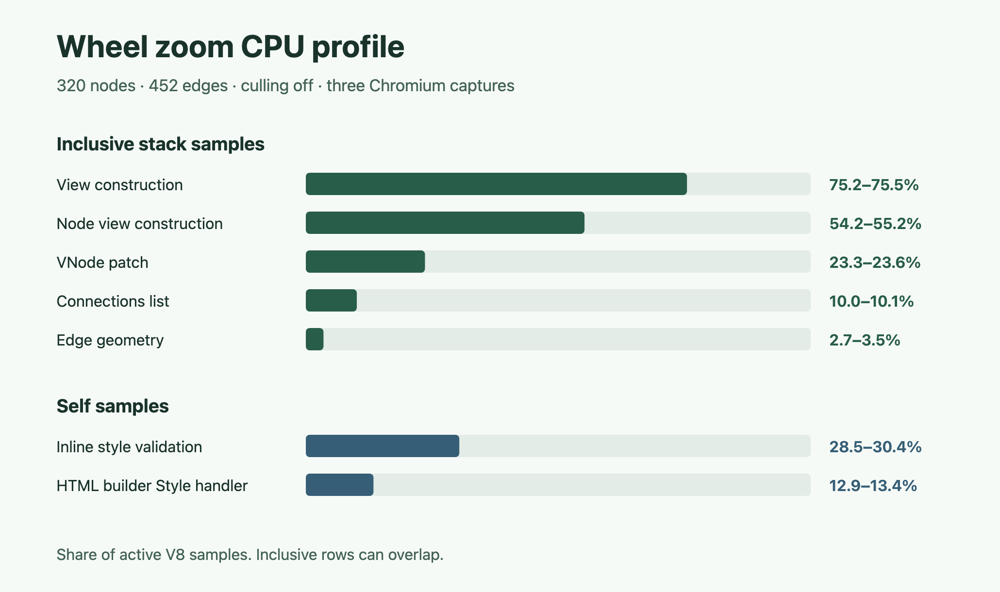
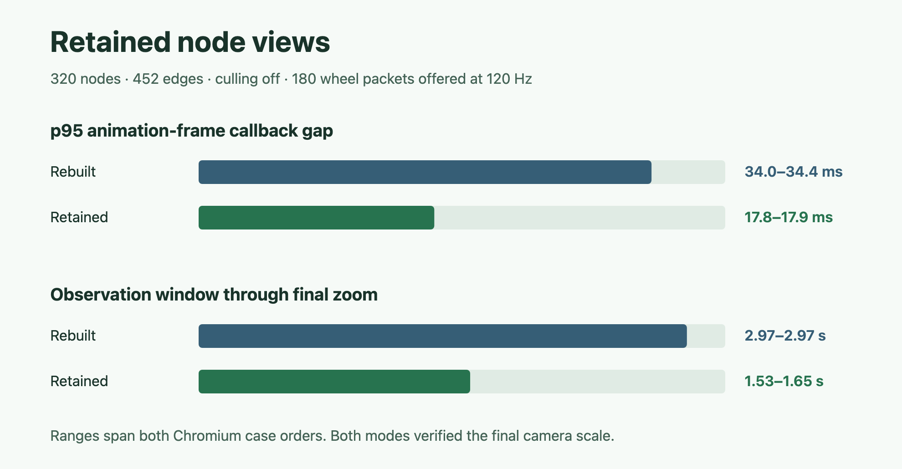
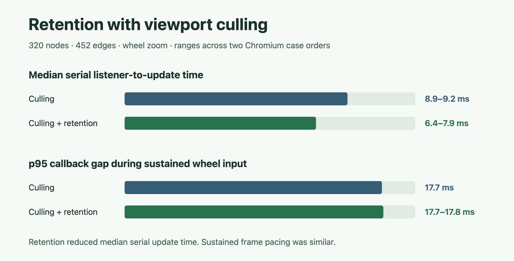

# Workbench camera benchmark

The large workflow contains 320 editable nodes and 452 edges across 20 lanes.
The browser driver compares the three-node release workflow with the large
workflow in default and Minimal modes. All cases use the production Astro
build, the default card renderer, and the same 1280 × 1100 viewport.

## Reproduce

From the repository root, build the workbench and run the driver from
`apps/web`, which provides the installed Playwright dependency.

```sh
bun run --filter @opsydyn/flow-sample build
cd apps/web
bun - < ../flow-sample/evidence/camera-benchmark.mjs
FLOW_BENCHMARK_REVERSE=1 bun - < ../flow-sample/evidence/camera-benchmark.mjs
```

Set `FLOW_BENCHMARK_SCREENSHOT` to an absolute PNG path to capture the large
workflow at Fit view. The driver prints counts and p50/p95 values as JSON and
fails if a sampled input doesn't change the camera or if the page reports a
runtime error.

## Method

Each case gets a fresh page. Each interaction starts near 100% zoom, with
three runs per case and four warm-up events before the 20 measured inputs in
each run. The driver sends trusted pointer or wheel input and waits for one
observed camera update and its subsequent animation-frame callback before
sending the next input. Pan travels 140 CSS pixels horizontally and 30
vertically, then returns. Zoom goes in ten steps and reverses ten steps.

The probe uses the event timestamp, the time at the capture listener, the
first observed world-transform change, and the next animation-frame callback.
Listener-to-update includes scheduling and the DOM patch. Event-to-frame
includes browser delivery and frame scheduling. These serial, headless
measurements are useful for comparison on the same machine. Continuous input,
display presentation, and paint latency require separate measurements.
[DOM mutation observers](https://dom.spec.whatwg.org/#mutation-observers) ·
[HTML animation frames](https://html.spec.whatwg.org/multipage/imagebitmap-and-animations.html#animation-frames)

## Local results

Headless Chromium 151.0.7922.34 on Apple M4 Pro, macOS 26.6.2, without CPU
throttling. Ranges show the two runs of the driver in forward and reverse case
order. Each case and interaction contributes 60 samples per order.

| Workflow          | Canvas elements | Pan listener to update p95 | Zoom listener to update p95 | Pan event to next frame p95 | Zoom event to next frame p95 |
| ----------------- | --------------: | -------------------------: | --------------------------: | --------------------------: | ---------------------------: |
| Release · default |              47 |                 1.3–1.5 ms |                  1.3–1.4 ms |                32.7–33.5 ms |                 50.9–51.2 ms |
| Large · default   |           5,657 |               29.0–34.5 ms |                28.3–29.1 ms |                42.4–49.5 ms |                 52.0–62.6 ms |
| Large · minimal   |           5,334 |               24.5–25.0 ms |                23.9–24.0 ms |                33.5–33.7 ms |                 50.8–50.9 ms |

Minimal mode reduced the full-page element count from 7,193 to 5,484 and
improved the large workflow's p95 in both orders. The large Minimal workflow
still took 23.9–25.0 ms at p95 from listener entry to the camera DOM update,
compared with 1.3–1.5 ms for the release workflow. The broader next-frame
metric varied with run order and includes browser scheduling.

A viewport-culling prototype is worth comparing against this baseline.
Use the same inputs and compare DOM size and listener-to-update p95. Keep
the graph, Fit view, minimap, and Connections list based on the full visible
workflow. This run measures the cost of the current path. Profiling or an
A/B run is needed to attribute savings to culling.

## Viewport culling comparison

Run the two-mode comparison from `apps/web` after building the workbench.

```sh
FLOW_BENCHMARK_COMPARE_CULLING=1 bun - < ../flow-sample/evidence/camera-benchmark.mjs
FLOW_BENCHMARK_COMPARE_CULLING=1 FLOW_BENCHMARK_REVERSE=1 bun - < ../flow-sample/evidence/camera-benchmark.mjs
```

This comparison uses default diagnostics in both modes and searches for the
zoom anchor near the middle of the workflow. Use these paired measurements
for the culling comparison. Each range covers the forward and reverse runs
on the same headless Chromium and host described above.

| Mode    | Mounted nodes / edges near 100% | Canvas elements | Pan listener to update p95 | Zoom listener to update p95 |
| ------- | ------------------------------: | --------------: | -------------------------: | --------------------------: |
| Default |                       320 / 452 |           5,657 |               26.7–26.9 ms |                26.8–27.3 ms |
| Culling |                         30 / 53 |             871 |               10.2–10.4 ms |                11.0–11.1 ms |

Culling removed about 85% of canvas elements and reduced listener-to-update
p95 by about 60%. Event-to-next-frame p95 changed by under 2 ms for pan
(31.8–32.5 ms default, 33.3–33.7 ms culled) and zoom
(49.7–50.3 ms default, 49.9–50.0 ms culled). Continuous input and
presentation timing remain separate measurements.

The driver confirmed that the minimap still showed all 320 nodes, the
Connections list exposed all 452 edges, and Fit view remounted the full
workflow. [Zoomed canvas and full minimap](viewport-culling.png)

## Sustained input profile

Run the burst profile from `apps/web` after building the workbench.

```sh
FLOW_BENCHMARK_BURST=1 bun - < ../flow-sample/evidence/camera-benchmark.mjs
FLOW_BENCHMARK_BURST=1 FLOW_BENCHMARK_REVERSE=1 bun - < ../flow-sample/evidence/camera-benchmark.mjs
```

The driver offers 180 Chromium input packets at 120 Hz in each burst. It
starts near 100% zoom and drives three bursts per operation and culling
mode. Pan holds the pointer down and advances it by 180 CSS pixels. Wheel
zoom sends 180 one-pixel steps around a fixed anchor. The driver verifies
that the camera reaches the expected endpoint and counts trusted events
delivered to the surface separately from packets offered. [Chromium input protocol](https://chromedevtools.github.io/devtools-protocol/tot/Input/#method-dispatchMouseEvent)

A mutation observer counts distinct camera transforms, including intermediate
changes delivered in one observer callback. The animation-frame probe
records callback gaps and the number of commits between callbacks. It starts
just before input and stops after the final camera update. The observation
window includes the tail of work after the last offered packet. These are
headless callback timings and DOM commits. Presented frames and reducer work
before a DOM commit require separate measurement. [DOM mutation observers](https://dom.spec.whatwg.org/#mutation-observers) · [HTML animation frames](https://html.spec.whatwg.org/multipage/imagebitmap-and-animations.html#animation-frames)

The paired runs used the same headless Chromium 151 build and Apple M4 Pro
as the serial benchmark, with default diagnostics. The driver offered each
burst in 1.491–1.494 seconds. Counts and observation windows are ranges
across six bursts per row. Frame-gap p95 is the range of the two case
orders, each calculated from its three bursts.

| Operation  | Culling | Events delivered / burst | DOM commits / burst | Frame gap p95 | Observation window |
| ---------- | ------- | -----------------------: | ------------------: | ------------: | -----------------: |
| Drag pan   | Off     |                    45–52 |               44–51 |  34.7–50.0 ms |      1.565–1.583 s |
| Drag pan   | On      |                  145–179 |                  91 |  17.8–18.4 ms |      1.531–1.534 s |
| Wheel zoom | Off     |                       92 |               87–89 |  49.0–50.1 ms |      3.017–3.417 s |
| Wheel zoom | On      |                  166–180 |               89–90 |  17.9–18.5 ms |      1.617–1.635 s |

Culling kept every observed callback gap below 25 ms. With culling off,
763 of 870 intervals exceeded 25 ms. The wheel observation window extended
well beyond packet dispatch with culling off, even though the final scale
matched the expected scale.

All 2,008 observed intervals contained at most one camera DOM commit.
Explicit frame batching has no duplicate DOM commits to eliminate in
these runs. To decide whether it can save work earlier, profile reducer
and view execution during the wheel burst with culling off and identify where the
extra time goes before testing a scheduler change.


## Wheel zoom CPU profile

The capture uses the same large workflow, default diagnostics, and culling
off. Each run starts at about 100% zoom, drives one warm-up burst, resets the
camera, then samples the next 180-packet, 120 Hz wheel burst through the
last verified camera update. Chromium's V8 profiler was configured to
sample every 1 ms. The production build enables source maps only for this
capture. The summary maps generated frames through the app map and then
through workspace package maps where available.
[Chrome DevTools Profiler protocol](https://chromedevtools.github.io/devtools-protocol/tot/Profiler/)

```sh
FLOW_BENCHMARK_SOURCEMAPS=1 bun run --filter @opsydyn/flow-sample build
cd apps/web
for trial in 1 2 3; do
  FLOW_BENCHMARK_CPU_PROFILE="/tmp/flow-wheel-$trial.cpuprofile" bun - < ../flow-sample/evidence/camera-benchmark.mjs
done
bun ../flow-sample/evidence/camera-cpu-summary.mjs /tmp/flow-wheel-{1,2,3}.cpuprofile
```

The three profiles used headless Chromium 151.0.7922.34 on the Apple M4 Pro.
All three reached the expected zoom, with 92 delivered events and 88
camera commits each. Capture windows were 3.019–3.035 seconds. V8 recorded
2,352–2,367 samples per capture, including 1,780–1,799 active stack samples.
The denominator excludes V8's idle, program, and garbage-collector frames.
Percentages describe sample shares. Inclusive rows can overlap with their
descendants, and the profile does not attribute Chrome's native paint or
compositor work.

| Sampled work                                    | Attribution | Active samples |
| ----------------------------------------------- | ----------- | -------------: |
| FoldKit render path                             | Inclusive   |          98.8% |
| FoldKit view construction                       | Inclusive   |     75.2–75.5% |
| Flow node view construction, including controls | Inclusive   |     54.2–55.2% |
| Flow port builder                               | Inclusive   |     17.9–18.8% |
| FoldKit VNode patch                             | Inclusive   |     23.3–23.6% |
| Connections list construction                   | Inclusive   |     10.0–10.1% |
| Edge geometry resolution                        | Inclusive   |       2.7–3.5% |
| Inline style validation                         | Self        |     28.5–30.4% |
| HTML builder Style handler                      | Self        |     12.9–13.4% |
| VNode attribute patching                        | Self        |       8.7–9.3% |

The camera changes the world transform while the workbench still rebuilds
node and port HTML. The largest measured opportunity is to reuse those
subtrees across camera-only updates. The CPU profiles support testing that
change with the same burst before pursuing edge routing or input scheduling.

[Representative Chromium CPU profile](wheel-zoom-unculled.cpuprofile)



## Retained node views

Use the same 180-packet wheel burst with culling off in both cases. The
comparison uses default cards and diagnostics and verifies the final zoom.

```sh
FLOW_BENCHMARK_COMPARE_RETAINED=1 bun - < ../flow-sample/evidence/camera-benchmark.mjs
FLOW_BENCHMARK_COMPARE_RETAINED=1 FLOW_BENCHMARK_REVERSE=1 bun - < ../flow-sample/evidence/camera-benchmark.mjs
```

The retained layer uses a FoldKit lazy slot to reuse the built-in node
and port VNodes across camera-only updates. The prototype preserves
style validation when it builds a subtree.

Both case orders used headless Chromium 151.0.7922.34 on Apple M4 Pro.
All 320 nodes and 452 edges remained mounted in both cases. Ranges cover
both case orders and six bursts per mode. The driver offered input in
1.491–1.493 seconds.

| Node views | p95 callback gap | Observation window | Camera commits per burst |
| ---------- | ---------------: | -----------------: | -----------------------: |
| Rebuilt    |     34.0–34.4 ms |      2.966–2.967 s |                    85–88 |
| Retained   |     17.8–17.9 ms |      1.533–1.650 s |                    89–91 |

These are headless animation-frame callback measurements. Chromium reached
the expected final zoom in both modes. The retained-view browser scenario
also verifies focus and DOM identity through zoom, graph editing, selection,
context-menu placement, port locks, and disabled controls during drag-pan.



## Retention with viewport culling

Both cases use culling, default cards, and default diagnostics. The
retained layer is reused when its mounted node set is unchanged. A
membership change rebuilds the layer from the Model. A browser regression
edits Publish, moves it outside the viewport, verifies focus keeps it
mounted, then blurs it and confirms Fit view remounts the edited node
with its port available.

Run the following from `apps/web` after building the workbench. Repeat
with `FLOW_BENCHMARK_REVERSE=1` to swap the case order.

```sh
FLOW_BENCHMARK_COMPARE_CULLED_RETAINED=1 bun - < ../flow-sample/evidence/camera-benchmark.mjs
FLOW_BENCHMARK_COMPARE_CULLED_RETAINED=1 FLOW_BENCHMARK_BURST=1 bun - < ../flow-sample/evidence/camera-benchmark.mjs
bun - < ../flow-sample/evidence/retained-node-views-browser.mjs
```

Paired runs on headless Chromium 151.0.7922.34 and Apple M4 Pro used the
same camera inputs in both modes. Serial ranges cover the two orders
with 60 samples per case in each order. Burst ranges cover both case
orders with six bursts per mode.

| Mode                  | Serial listener to update p50 | Serial listener to update p95 | Burst callback gap p95 | Burst observation window |
| --------------------- | ----------------------------: | ----------------------------: | ---------------------: | -----------------------: |
| Culling               |                    8.9–9.2 ms |                  10.7–11.1 ms |                17.7 ms |            1.633–1.634 s |
| Culling and retention |                    6.4–7.9 ms |                   9.6–11.5 ms |           17.7–17.8 ms |            1.633–1.634 s |

Retention reduced median serial update time. The p95 update ranges
overlapped, and sustained wheel pacing was effectively unchanged.
Both cases ended the serial run with 30 nodes and 53 edges mounted
and the burst run with 16 nodes and 35 edges mounted. The minimap and
Connections list retained the full visible workflow.


