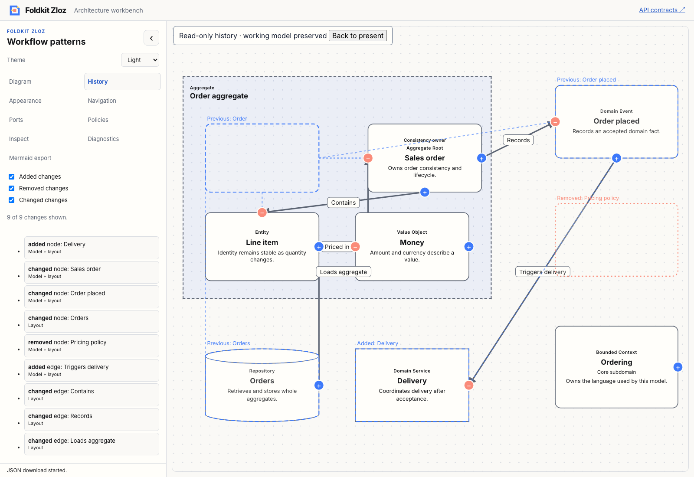
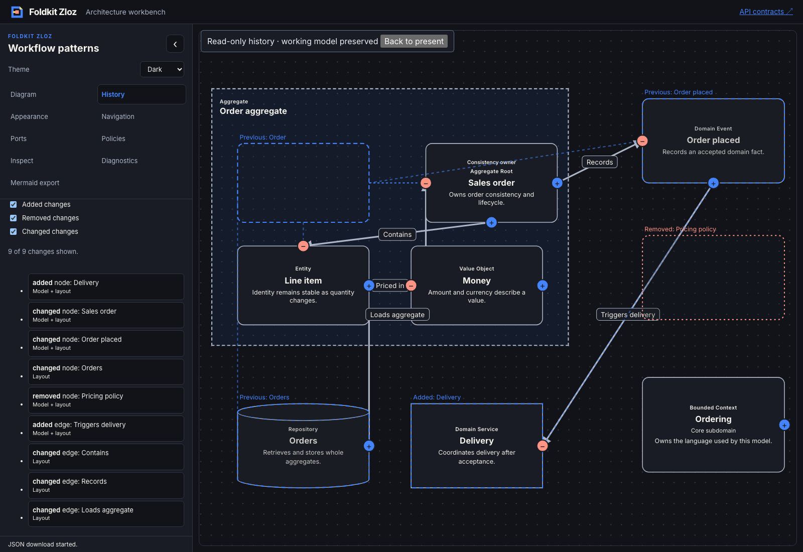

# Composable history change navigation — 2026-11-09

- **result:** complete
- **claim:** consumers can compose a package-owned change list with Added/Removed/Changed filters, custom entries and explicit camera-focus requests. The workbench demonstrates current and removed geometry while preserving the working editor, Undo, edition archive and ghost preferences.
- **evidence:** baseline checks and workspace check/typecheck/tests exited 0, including real tarball consumers under Node/Bun and Bundler/NodeNext type resolution. Six focused core/native-rendering tests passed after helper refinements; all 51 workbench tests and their TypeScript check passed. Final camera-fitter export qualification reran real tarball consumers, workbench checks and the browser flow. Production demo and API documentation builds passed. The [Chromium transcript](change-navigator-browser.json) verifies filters and empty results, native Enter activation with retained keyboard focus, earlier ghost geometry in the viewport, focus pausing playback, rejected old ticks, and exact working-model export/prior-Undo preservation. Light/dark screenshots were inspected.
- **remaining uncertainty:** local qualification only. Existing workspace warnings/skips remain. Native keyboard/attribute checks are not comprehensive assistive-technology acceptance. Removed-edge framing uses baseline endpoint geometry, since computed routes are outside portable snapshots. No performance benchmark, hosted CI, deployment, npm publication, persistence migration or automatic ghost activation is claimed.
- **next:** typed event-storming causal relationships with explainable validation between commands, events, policies and aggregates, building on the existing notes and process starter. Recommendation: **needs review**.

[ADR 0029](../../../docs/adr/0029-navigate-history-comparison-changes.md) records the contract. Core separates node and edge identity, derives counts from the unfiltered comparison and scopes requests to both edition IDs plus entity type/ID. The fresh resolver ignores stale/unknown/filtered targets and applies current global/individual policy before returning an existing reveal event or earlier geometry for camera fitting. Requests carry no saved camera coordinates or ordinals. The existing `fitNodes` geometry primitive is exported so earlier bounds can frame the camera directly without a synthetic graph.

Optional native helpers and nullable slots support custom filters, entries, names, status/reason content and layout. The workbench uses custom badges and preserves model/layout annotations. Minimal mode can omit the numeric result summary. Filters stay independent of playback and ghost settings. A valid focus pauses the host timer; stale requests cannot interrupt playback. Scope, measurement and active-operation guards are shared by view and update. Removed items are never inserted back into either graph.

Architecture, delivery and test-quality reviews are **self-review**. Initial tests failed on missing exports. During qualification, fixture ports were corrected to include required offsets, existing restore/fork view dependencies were retained, and the playback regression was scoped to a non-final edition to exercise active playback. Final core/rendering, app, packed-consumer, workspace and browser checks passed. Unrelated untracked files were preserved.

