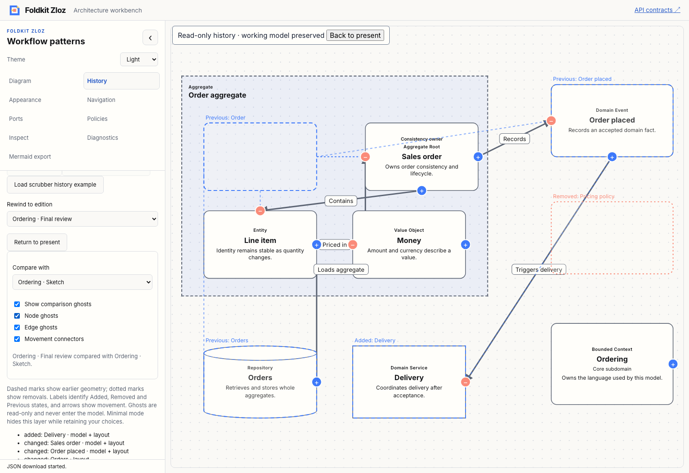
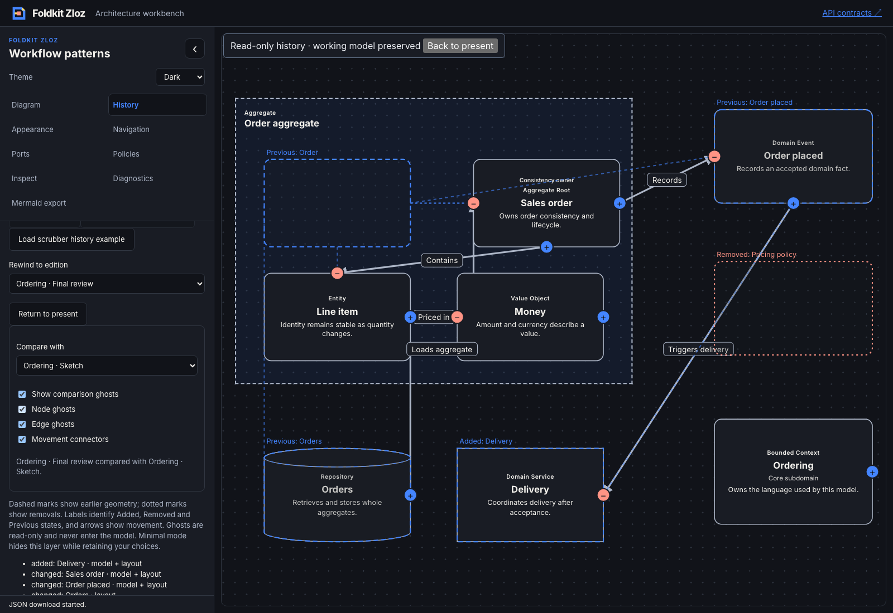

# Composable history comparison controls — 2026-11-09

- **result:** complete
- **claim:** consumers can compose package-level baseline and ghost controls, with stable edition identity, current host restrictions, independent layer preferences and minimal-mode visibility. The workbench uses the public context for its custom sidebar and canvas layer and the request resolver for updates, preserving playback behavior and the working editor/Undo.
- **evidence:** baseline and final workspace lint/format and typecheck exited 0; all workspace tests passed, including packed Node/Bun consumers and workbench comparison/playback regressions. Eight focused core/native-rendering tests passed after the final helper refinements. All 47 workbench tests and their TypeScript check passed after the final adapter correction. Production demo and API docs builds passed. The [Chromium transcript](comparison-controls-browser.json) verifies independent layers, preference retention through master/minimal mode, current-edition exclusion, live ghost preferences during play, baseline selection pausing play, and exact exported working-model/prior-Undo preservation. Light/dark screenshots were inspected.
- **remaining uncertainty:** local qualification only. Existing workspace warnings and skips remain. Native control/attribute checks are not comprehensive assistive-technology acceptance; no hosted CI, performance benchmark, deployment, npm publication, new archive format or change-list navigator is claimed.
- **next:** a package-owned comparison change navigator with composable Added/Removed/Changed filters and explicit focus requests, connecting the accessible changes list to canvas exploration. Recommendation: **needs review**.

[ADR 0028](../../../docs/adr/0028-compose-history-comparison-controls.md) records the ownership boundary. Core consumes edition metadata and UI preferences, derives visible controls and effective ghost settings, and returns ready/unchanged/ignored/blocked decisions. Unknown/self baseline requests preserve existing choices; clearing is explicit. Stored stale IDs do not silently select substitutes. Duplicate IDs reject. Toggle facts use fresh preferences, and newly applied host policies veto older requests. No graph, Undo, timer or persistence contract is changed.

The optional Foldkit composition exposes native select/checkbox helpers, status, visible reasons, nullable renderer slots, ordered layer subsets and a layout hook. Text labels, attributes and custom content remain host-controlled. The workbench customizes wrappers and uses its existing accessible changes list and ghost legend. Baseline requests pause its existing timer; ghost preferences stay live during playback. The host continues to own callback lifetimes and read-only projection.

Architecture, delivery and test-quality reviews are **self-review**. The initial focused test failed on missing public exports before implementation. Subsequent core/rendering, packed-consumer, app, workspace and browser checks passed. Self-review caught and corrected the workbench adapter mapping absolute visibility requests to toggles; a new idempotence regression covers the absolute-value path. Unrelated untracked files were preserved.

