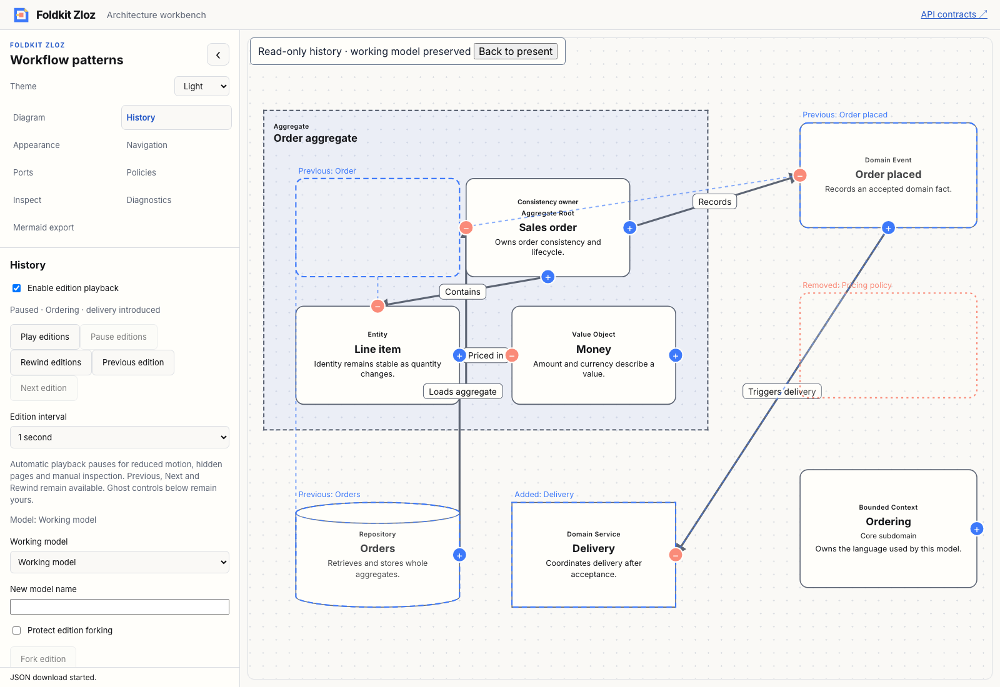
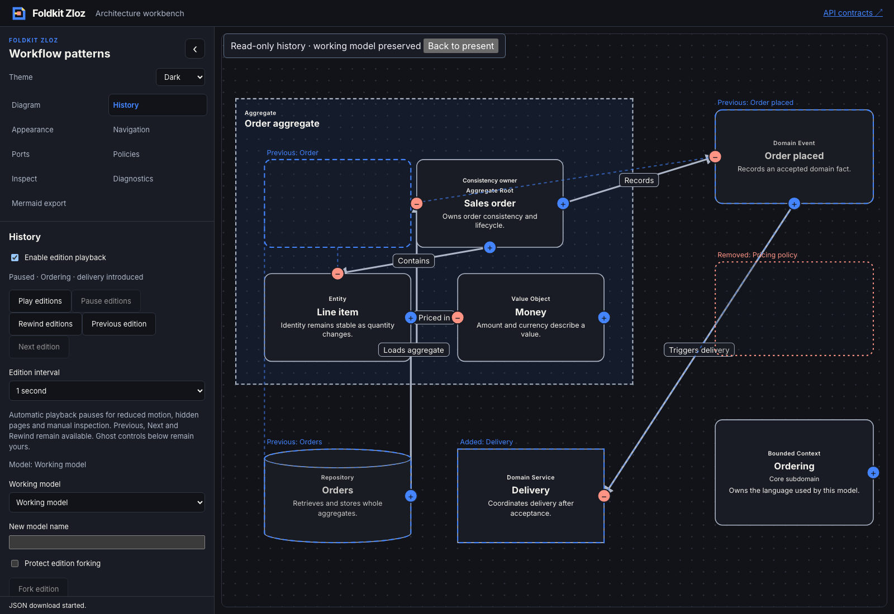
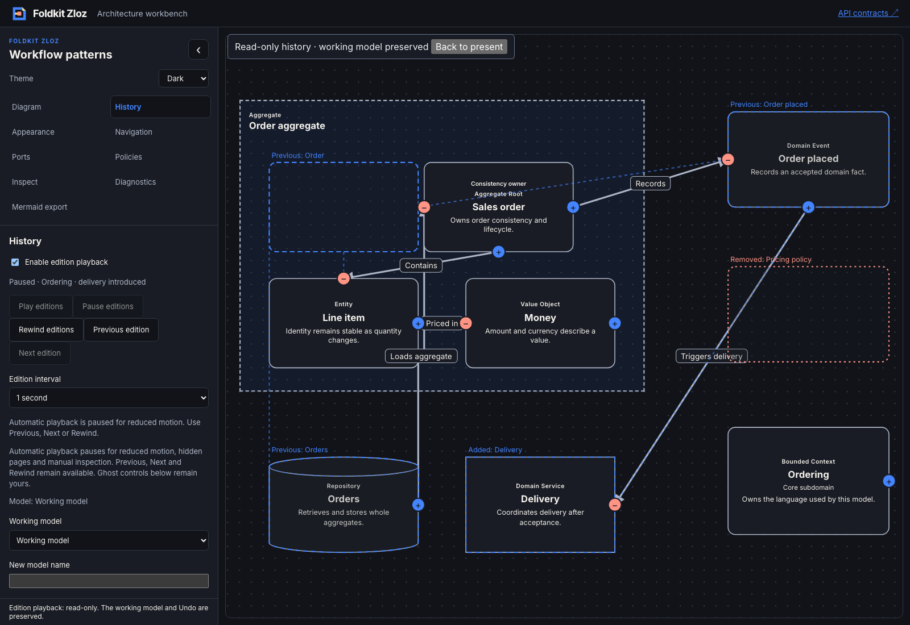

# Opt-in edition playback — 2026-11-09

- **result:** complete
- **claim:** package users can drive a pure opt-in edition cursor with play, pause, rewind, manual steps, seek and timing events. The workbench composes it with read-only history and optional ghosts while preserving the working model and Undo, respecting live reduced motion and rejecting stale scoped ticks.
- **evidence:** baseline and final workspace `bun run check`, `bun typecheck`, `bun run test` exited 0; focused core typecheck/tests and app regressions passed. Packed consumers exercise runtime/TypeScript contracts under Node and Bun without optional UI dependencies. Production demo and TypeDoc builds passed. The [Chromium transcript](edition-playback-browser.json) records real delayed advancement, pause, end behavior, ghosts, rewind, live reduced-motion changes, preserved export and prior Undo. Light/dark/reduced-motion screenshots were inspected.
- **remaining uncertainty:** local qualification only. Existing warnings and intentional skips remain. Hidden-page pause is reducer-qualified; a native background-tab transition and comprehensive screen-reader acceptance were not manually qualified. No hosted CI, deployment, npm publication, interpolation, looping, wall-clock catch-up or persisted playback session is claimed.
- **next:** composable package-owned transport controls, status and availability reasons, with renderer slots for complete visual control. Recommendation: **needs review**.

[ADR 0025](../../../docs/adr/0025-add-opt-in-edition-playback.md) records the separation between core cursor, edition store and host clock/lifecycle. Core stores pinned ordered IDs, not graphs or browser resources. Empty/paused/playing are explicit; only playing carries elapsed time. Each elapsed event advances at most one edition and discards overshoot. Reduced motion defaults safe and never auto-resumes. Portable formats and runtime dependencies are unchanged.

The workbench uses an Effect Stream subscription gated by playing state and scoped to model/run identity. Stream.tick's immediate emission is skipped so the first edition receives a full interval. Manual inspection, fork naming, return to present, model/collection changes, reduced motion and hidden-page events stop playback; old callbacks cannot republish a projection. Canvas epochs remain separate so automated projections do not restart the transport clock. Ghost toggles remain user-owned.

Tests cover detached playlist order, uniqueness/timing errors, end/replay behavior, partial elapsed reset, overshoot, manual steps/seek, reduced motion, malformed stale ticks, busy operations, visibility, collection changes and model-switch round trips. Browser evidence compares the full unchanged working document and verifies its earlier Undo remains available. The initial browser Undo assertion assumed a keyboard step size; it was replaced with exact comparison to the captured original graph, and the final journey passed.

Architecture, delivery and test-quality reviews are self-review. Native controls and polite status updates reuse existing Foldkit semantics; they do not constitute comprehensive assistive-technology qualification.

