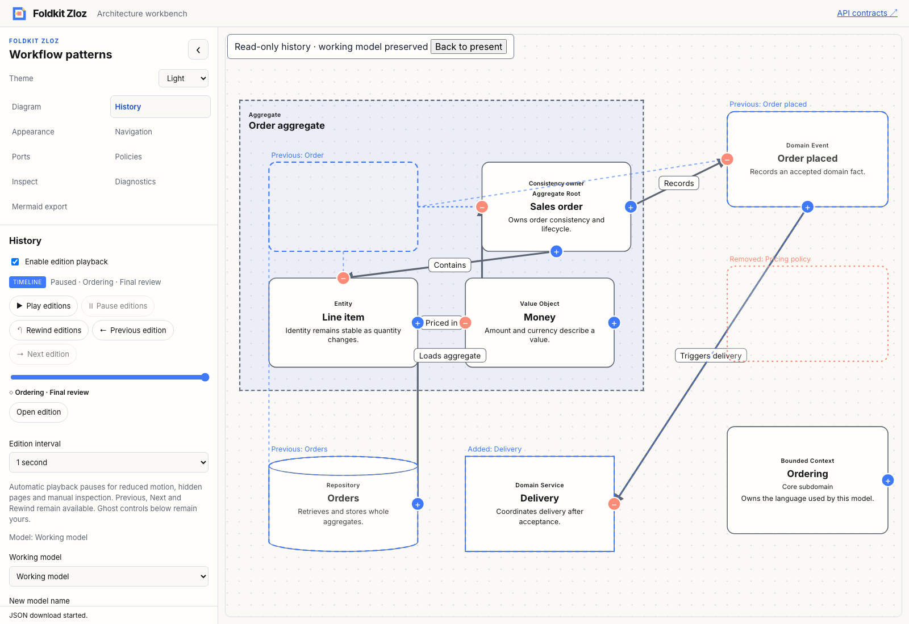
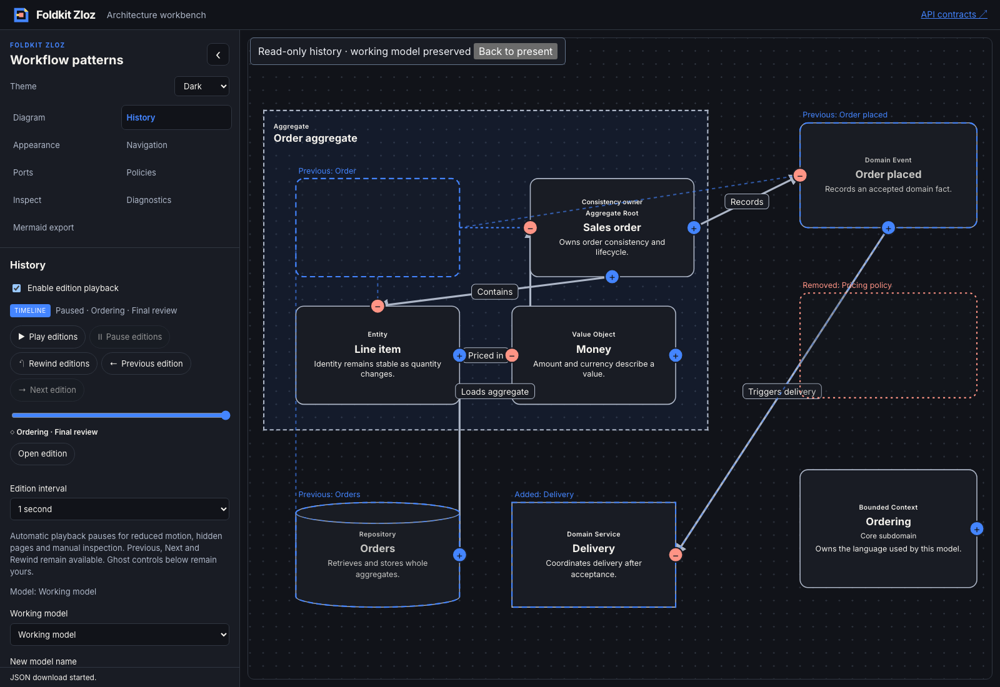

# Composable edition scrubber — 2026-11-09

- **result:** complete
- **claim:** package users can compose a native edition scrubber with custom labels/value text, explicit current-point opening and identity-safe seek decisions. The workbench demonstrates eight named checkpoints, preserves the working model/Undo and rejects stale seek callbacks through a dedicated host session.
- **evidence:** baseline and final workspace check/typecheck/tests exited 0; focused core/view/app tests passed. Packed Node/Bun consumers exercise pure seek decisions and typed custom Foldkit rendering. Production demo and API docs builds passed. The [Chromium transcript](edition-scrubber-browser.json) verifies Enter opening, End/Home/Arrow seeking with retained focus, continuous native pointer dragging, reduced-motion seeking, playback pause, ghost comparison and exact working-model/prior-Undo preservation. Light/dark captures were inspected.
- **remaining uncertainty:** local qualification only. Existing warnings/skips remain. A 1,000-entry identity test is not a throughput benchmark. Native keyboard/attribute checks do not constitute comprehensive assistive-technology acceptance. No hosted CI, deployment, npm publication, new cursor/draft selection, timer or portable format is claimed.
- **next:** package-owned comparison controls for baseline selection and ghost visibility, so consumers can compose the complete review workflow. Recommendation: **needs review**.

[ADR 0027](../../../docs/adr/0027-seek-editions-with-a-composable-scrubber.md) records the ordinal-to-identity boundary, manual-seek restrictions and callback ownership. Malformed/out-of-bounds input never clamps to another edition. Requests resolve again against current IDs and host policy; successful EditionSelected events pause the existing playback cursor. Reduced motion limits automatic playback, not manual seeking.

The optional Foldkit entry exposes a native range, non-live readout, visible reason, explicit Open button and composition with replaceable/nullable parts and layout. A single edition locks the range but remains explicitly openable. Native value text uses human labels rather than forcing visible ordinal readouts. No DOM IDs or hidden runtime resources are generated. Custom markup owns its semantics when it replaces the native helpers.

The workbench separates seek-session identity from timer runs and canvas epochs. Successive inputs keep their session; present/sidebar/model return trips, collection changes, disable/re-enable, working edits and hidden-page transitions invalidate it. Tests replay old intents after these boundaries, including a same-model return trip. Live busy policy blocks seeking during document operations. The eight-checkpoint archive is synthetic sample data and is merged atomically/idempotently without replacing current content.

Architecture, delivery and test-quality reviews are self-review. Initial core tests failed on missing exports. Implementation qualification corrected the native builder spelling to AriaValuetext before the final successful checks. Existing snapshot/model serialization and source Undo remain unchanged.

