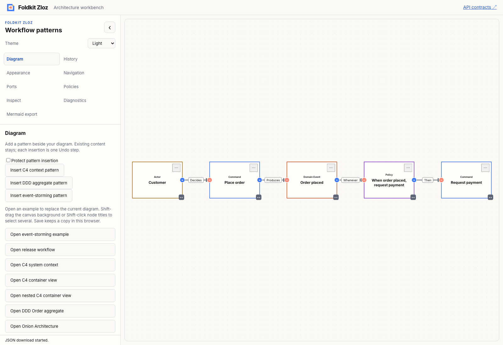
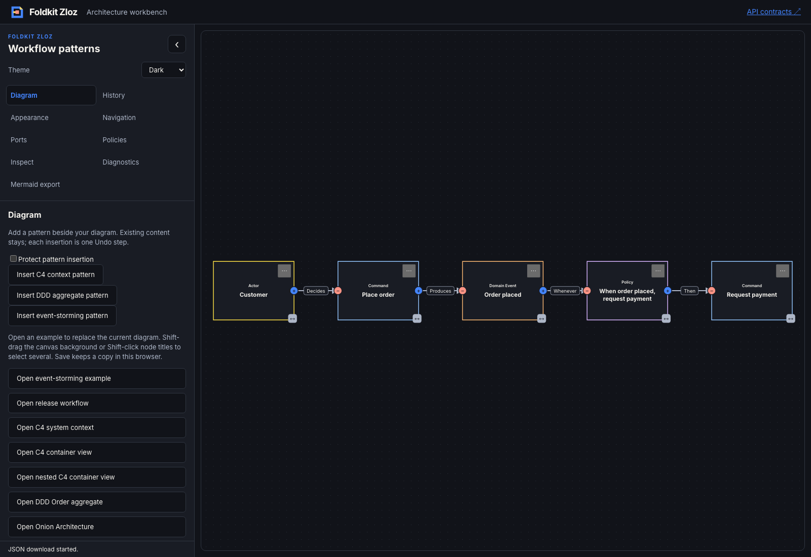

# Event-storming notes — 2026-11-09

- **result:** complete
- **claim:** package users can model command, domain-event, policy and actor notes, customize their native Foldkit renderer/theme, and insert a process starter with the existing atomic Undo contract. The workbench demonstrates the same package APIs.
- **evidence:** baseline and final workspace check/typecheck/test commands exited 0; focused semantic/renderer tests passed; production demo and API docs builds passed. Packed Node/Bun consumers qualify pure core, typed renderer slots and scoped tokens. Mermaid tests prove strict rejection/reporting of semantic metadata loss. The [Chromium transcript](event-storming-browser.json) verifies insertion protection, original-node preservation, Undo/Redo, edition capture, portable model reopen, renderer selection and role legend. Both final screenshots were inspected.
- **remaining uncertainty:** local qualification only. Existing warnings/skips remain. No hosted CI, deployment, npm publication, complete workshop vocabulary, executable policies or causality enforcement is claimed. Older cores can reject the unfamiliar semantic family. Comprehensive assistive-technology qualification remains the later product gate.
- **next:** opt-in deterministic edition playback with pause, rewind and reduced-motion handling, retaining existing ghost comparisons. Recommendation: **needs review**.

[ADR 0024](../../../docs/adr/0024-add-event-storming-process-notes.md) records the separate semantic family, alternatives and limits. Core remains dependency-free. Graph, snapshot, edition and model envelopes stay version one; existing C4/DDD fixtures still pass. The optional Foldkit renderer uses existing outline geometry, native sockets, controls and body-cache boundaries. Role text accompanies customizable light/dark accents.

Tests reject mixed roles, unknown reserved fields and group-boundary misuse; cover literal version-one input, graph/model round trips, protected semantic edits and Undo; and exercise content omission/replacement, live source/read-only feedback outside artwork caching, and packed runtime/TypeScript APIs. The workbench preserves visual mode on insertion and selects the semantic renderer when reopening notes. Native control/name checks do not substitute for screen-reader acceptance.

Architecture, delivery and test-quality reviews are self-review. Initial semantic tests failed before implementation. One local packed-adapter run was blocked by sandbox npm-cache access; the full authorized workspace run passed without changing cache ownership. Screenshot review exposed crowded edge labels; final starter spacing was widened and the browser journey rerun successfully.

