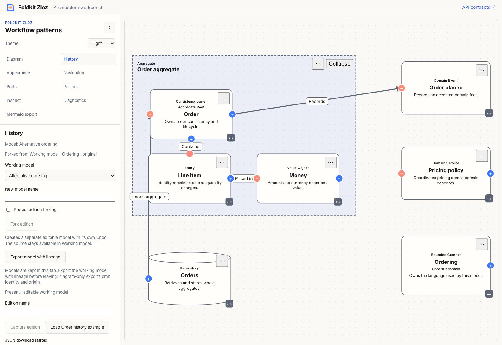
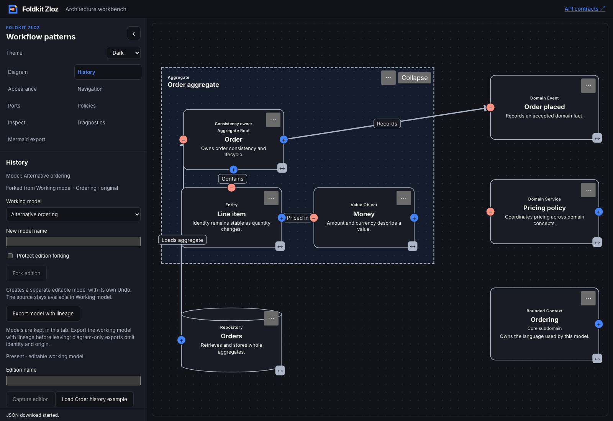

# Model identity and edition forks — 2026-11-09

- **result:** complete
- **claim:** a package-owned edition fork creates a separate immutable model with pinned immediate origin, independent editing and Undo, without replacing the source.
- **evidence:** full workspace check/typecheck/tests, strict codec and packed Node/Bun consumer tests, app ownership/busy/policy tests, API/demo builds and the [Chromium transcript](model-forks-browser.json). Light/dark screenshots were inspected locally.
- **remaining uncertainty:** model import and CLI adapters for the new envelope are separate work. Model IDs are host-allocated within their registry; cross-registry collision handling remains explicit. No autosave, ancestry DAG/merging, collaboration, deployment, hosted CI or npm publication is claimed.
- **next:** integrate model-document import/CLI validation without dropping lineage, then atomic pattern insertion. Recommendation: **needs review**.

## Boundary and compatibility

[ADR 0021](../../../docs/adr/0021-fork-editions-with-explicit-model-lineage.md)
records the independent `foldkit-zloz-model` v1 envelope. Graph/snapshot and
edition-archive v1 are unchanged. A fork selects an edition in the source's own
collection, preserves local diagram/port/group references, pins the exact source
edition and creates its own empty edition collection. Origin identifies the
immediate parent only; it is not a verified ownership attestation.

The pure core exports document capture/parse/serialize, fork and fresh editor
initialization. It adds no Effect, Foldkit, layout or browser dependency. Host
policy controls destination creation; read-only source editing is separate from
permission to copy. Invalid structure throws the canonical core error; expected
identity/permission failures return a blocked decision.

The workbench keeps only active identity plus parked editor/edition sessions in
its Foldkit Model. Each model retains its own renderer, graph and Undo. Canvas
identity/session tokens reject stale callbacks, including return trips and
historical projections. A keyed canvas section remounts its resources while the
sidebar remains stable. Busy edits/imports/layout block switching or forking;
local-storage reads share the existing request/revision guard. The custom
Undo/Redo controls now reflect the selected model's actual history availability.

Export model JSON preserves identity, snapshot, editions and origin. Existing
CLI/diagram import accepts its original graph/snapshot formats, rejects the new
envelope and does not silently project away metadata. `parseModelDocument` is the
supported SDK entry point. Workbench models and Undo remain tab-owned.

## Qualification

- Baseline full workspace typecheck and check passed before implementation.
- The first core/app tests failed on missing public fork exports/messages.
- Final full `bun run check`, `bun typecheck`, `bun run test`: exit 0. Intentional
  existing skips and warning annotations remain visible in the command receipts.
- Core tests cover immutable/detached origin, parent/endpoint/local ID preservation,
  fresh Undo, source preservation, policy/identity rejection, strict codec errors,
  unchanged snapshot v1, host editor preferences and fork-of-fork immediate origin.
- The packed consumer imports the new public types/functions, compiles with Bundler
  and NodeNext, round-trips origin and runs with Node/Bun alongside existing API
  contracts. No new runtime dependency is introduced into core.
- Workbench reducer tests cover parked editors/Undo, live policy, busy sessions,
  late import/canvas events, same-model return trips and historical payload gating.
- Production demo and TypeDoc builds passed. Chromium exercises the real export,
  fork, source/fork Undo/Redo and switch workflow with no page errors.
- Architecture, delivery and test-quality review are self-review. The first browser
  run exposed enabled empty-history Undo; the corrected availability is covered by
  the final journey. Scoping initially exposed retained old mount callbacks;
  keyed canvas resource ownership fixed that failure and the journey passes.

