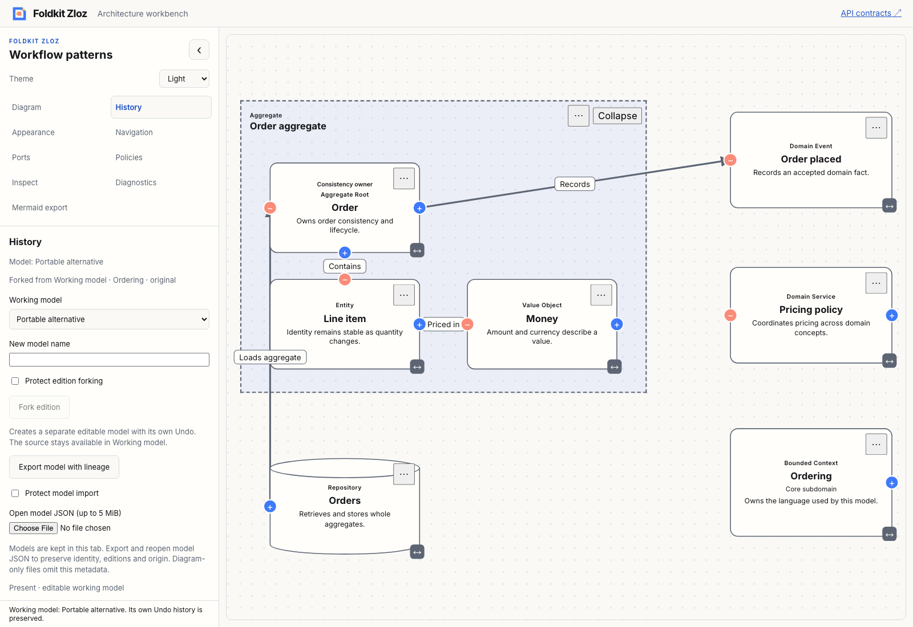
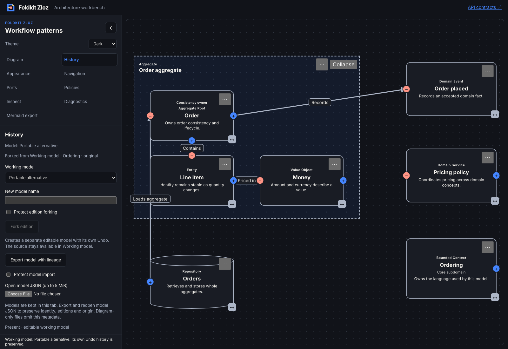

# Portable model adapters — 2026-11-09

- **result:** complete
- **claim:** workbench model JSON import preserves identity, pinned origin, editions and camera in a separate session. Effect CLI validation recognizes the full document, and Mermaid export requires explicit consent for metadata loss.
- **evidence:** full workspace `bun run check`, `bun typecheck` and `bun run test`; production demo and API docs builds; packed Node/Bun consumer validation and strict/report conversion tests; [Chromium transcript](model-import-browser.json). Light/dark screenshots below were inspected. Existing fork and edition-restore browser journeys also passed with no page errors.
- **remaining uncertainty:** local qualification only. Sessions and Undo remain tab-owned; no autosave, collision reconciliation, ancestry merging, hosted CI, deployment or npm publication is claimed. Existing warning annotations and intentional test skips remain visible in check output.
- **next:** package-owned atomic pattern insertion with collision-safe IDs, preserved internal references and one Undo step. Recommendation: **needs review**.

[ADR 0022](../../../docs/adr/0022-integrate-model-documents-with-workbench-and-cli.md) records the adapter boundary. Core model/snapshot/archive codecs remain unchanged. The CLI owns projection diagnostics and keeps graph validation responses compatible; public `readGraph` rejects implicit model projection while `readDocument` preserves the tagged document.

Workbench import uses bounded fatal UTF-8 decoding, cancellable keyed Commands, request/epoch/revision/graph guards, live permission checks and duplicate-ID rejection. A Command-allocated namespace replaces the fixed production identity. The Preparing/Ready/Failed shell lifts the existing editor through Foldkit child view, update and subscription APIs. Imported models receive fresh Undo; parked sessions retain theirs.

Tests include invalid/future envelopes, malformed UTF-8, oversized files, cancelled and stale completions, revision-reset graph replacement, revoked permission and camera zoom beyond source limits. Browser evidence exercises an exported fork reopened after reload, exact full-document round trip, conflict/error rejection, protection and independent Undo/Redo. Architecture, delivery and test-quality reviews are self-review.

