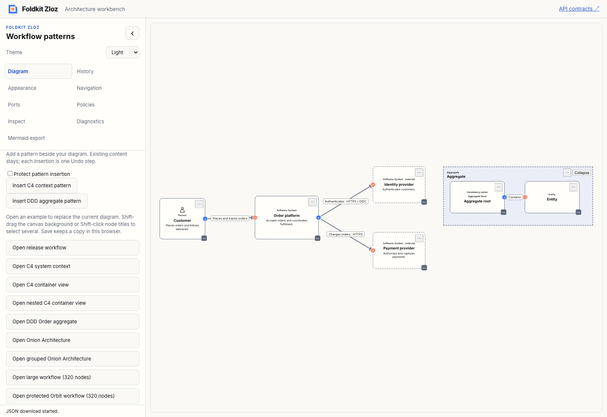
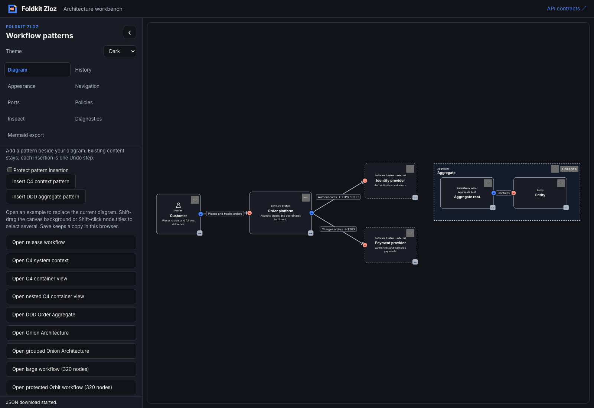

# Atomic pattern insertion — 2026-11-09

- **result:** complete
- **claim:** core inserts self-contained custom or built-in C4/DDD graph fragments with fresh IDs, preserved internal references, live policy checks and exactly one Undo step. The workbench demonstrates additive insertion and explicit protection.
- **evidence:** full workspace `bun run check`, `bun typecheck` and `bun run test` exited 0; focused core typecheck and behavioral tests passed; packed Node/Bun consumers exercised runtime and TypeScript exports without optional UI dependencies. Production demo and TypeDoc builds passed. The [Chromium transcript](pattern-insertion-browser.json) verifies protection, mixed C4/DDD insertion, exact existing-graph preservation and Undo/Redo. Both screenshots below were inspected.
- **remaining uncertainty:** local qualification only. Existing warnings and intentional skips remain. No hosted CI, deployment, npm publication, automatic placement/layout, external wiring or opaque host-data reference rewriting is claimed. Pattern placement uses an explicit world offset; the workbench places beside existing content and users can fit the view through Navigation.
- **next:** event-storming semantic primitives for commands, domain events, policies and actors, followed by a starter using the same insertion contract. Recommendation: **needs review**.

[ADR 0023](../../../docs/adr/0023-insert-self-contained-patterns-atomically.md) records the contract and alternatives. Core reuses graph validation/copying, connection policies and the existing graph transaction boundary. Persistence formats and dependencies are unchanged. Callers receive separate node/edge ID maps; ports remain node-local and JSON data stays opaque.

Behavioral tests cover repeated insertion, nested parent mapping, endpoint/port preservation, destination and fragment ID collisions, detached payloads, invalid fragments/offsets, read-only/busy/Undo-disabled editors, empty fragments, whole-pattern and endpoint vetoes, a later-edge veto rejecting the entire batch, selection policy and exact Undo/Redo. Workbench reducer tests preserve model identity, editions and visual mode, and reject direct dispatch while protected or importing.

Architecture, delivery and test-quality reviews are self-review. Initial tests failed on missing exports. Browser verification caught an automatic global-renderer change that resized existing C4 nodes; insertion now preserves the chosen visual mode, and C4/DDD preset renderers compose both families. The final browser journey asserts the original graph stays exact. Comprehensive assistive-technology qualification remains the later product gate.

