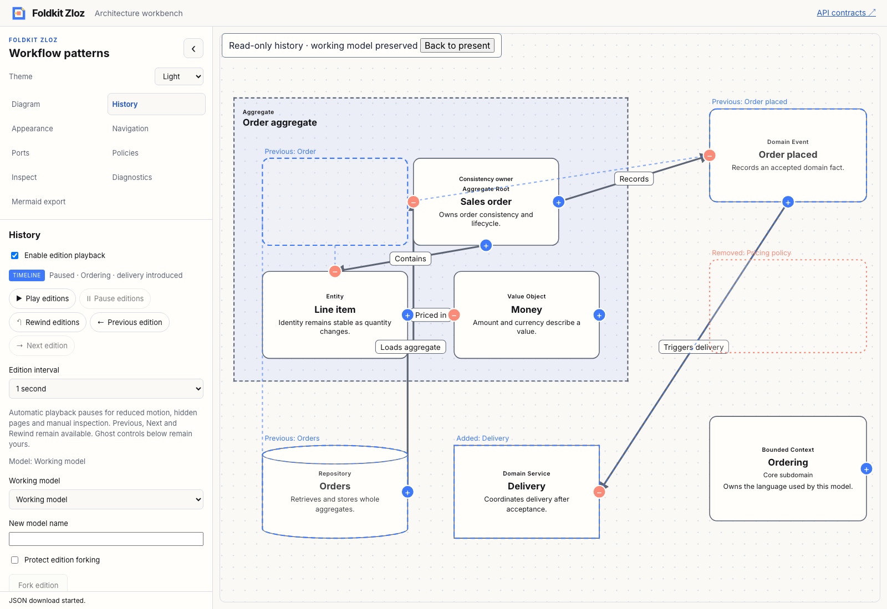
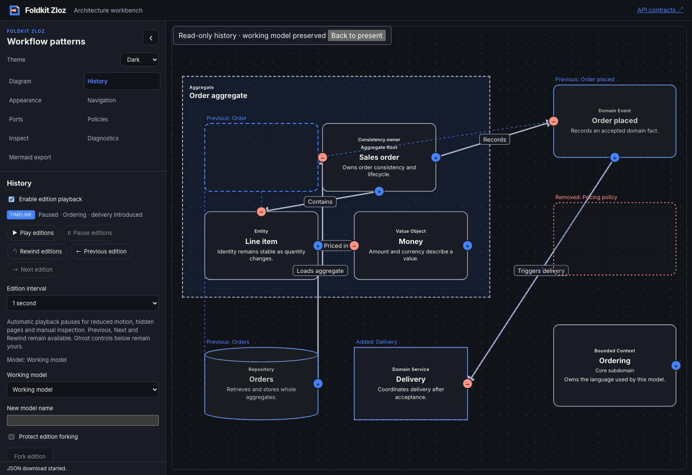
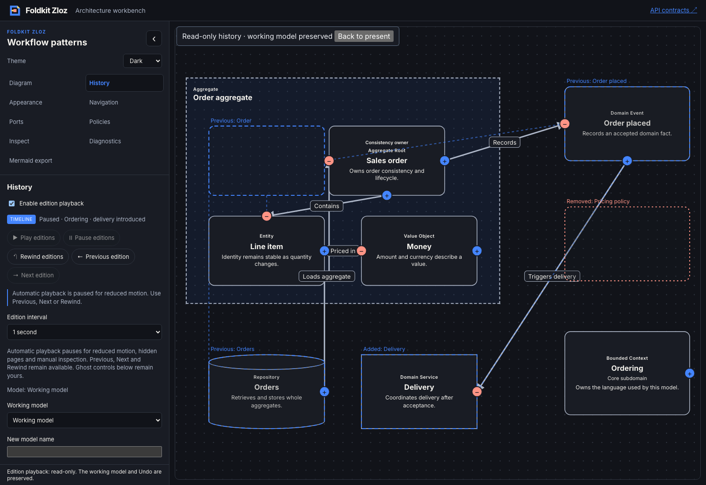

# Composable playback controls — 2026-11-09

- **result:** complete
- **claim:** core derives playback actions, status and availability reasons; optional Foldkit helpers expose native controls and customizable composition. The workbench consumes the public APIs with icon pills, a timeline badge and custom reason/layout slots, retaining host-owned playback lifecycle and update guards.
- **evidence:** baseline and final workspace check/typecheck/test commands exited 0, with a focused final core typecheck. Seven resolver/renderer tests cover availability, slots and native semantics. Packed Node/Bun consumers qualify pure core and custom typed Foldkit rendering. Production demo and API docs builds passed. The [Chromium transcript](playback-controls-browser.json) verifies the public control group, native Enter activation, disabled reason descriptions, live reduced motion, timed playback, ghosts, exact working-model preservation and prior Undo. Light/dark/reduced-motion screenshots were inspected.
- **remaining uncertainty:** local qualification only. Existing warnings and intentional skips remain. Native attribute/Enter checks do not constitute comprehensive screen-reader or keyboard acceptance. Custom HTML outside the native helpers owns its own semantics. No hosted CI, deployment, npm publication, new clock, subscription or persistence format is claimed.
- **next:** a package-owned edition scrubber with explicit seeking and customizable labels, so long histories can be navigated without stepping through every edition. Recommendation: **needs review**.

[ADR 0026](../../../docs/adr/0026-compose-package-playback-controls.md) records the separation of view projection, native composition and host authority. Host reasons add vetoes; core reduced-motion/count/boundary guards remain, and active Pause stays available. Blank denials retain a nonempty explanation. Contexts do not authorize stale actions: the existing workbench update and scoped timer guards remain authoritative.

The unstyled group supports ordered control subsets, per-control/status/reason slots and a layout hook. Undefined retains defaults; null omits parts. Individual native helpers support independent frames, custom children and labels, and caller-supplied keys through attributes. They preserve button types, accessible names, disabled flags, reason descriptions and polite status semantics. There are no generated DOM IDs or hidden state resources.

Tests cover empty/single/playing/end states, host vetoes, reduced motion, active Pause, subset deduplication, default fallback, complete part omission, localization, custom layouts and conflicting native attributes. The workbench removes duplicated availability rules and demonstrates custom visuals through helpers rather than CSS overrides. Architecture, delivery and test-quality reviews are self-review.

Initial tests failed before the resolver export existed. Packed-consumer qualification caught a widened literal in the synthetic test event adapter; an explicit EditorEvent return type corrected that fixture. The packed check and full workspace suite then passed.

