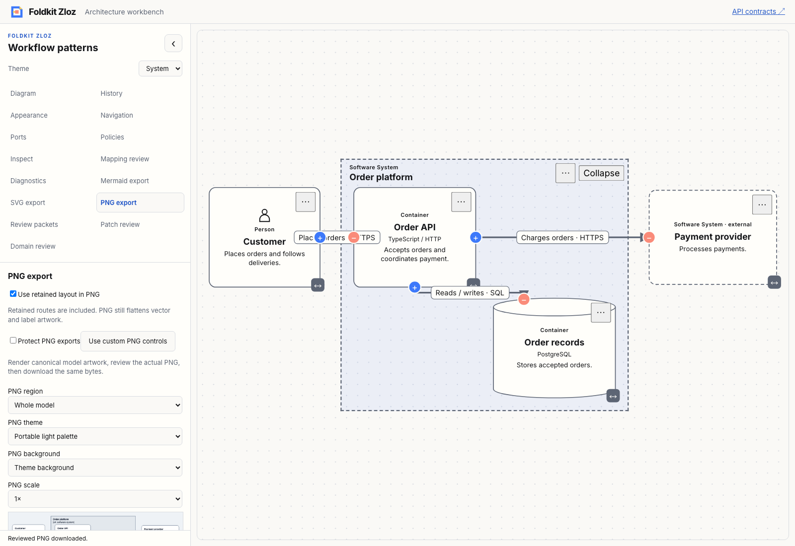
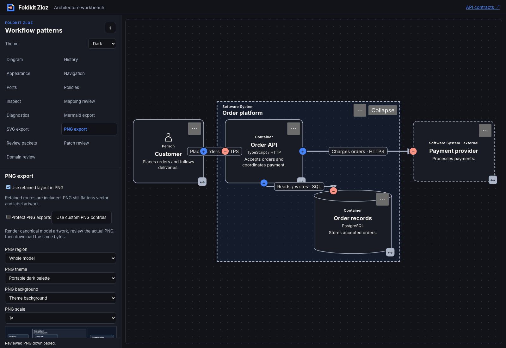
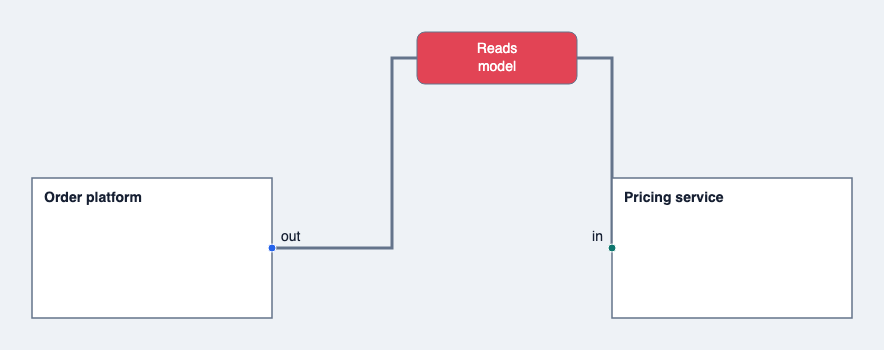
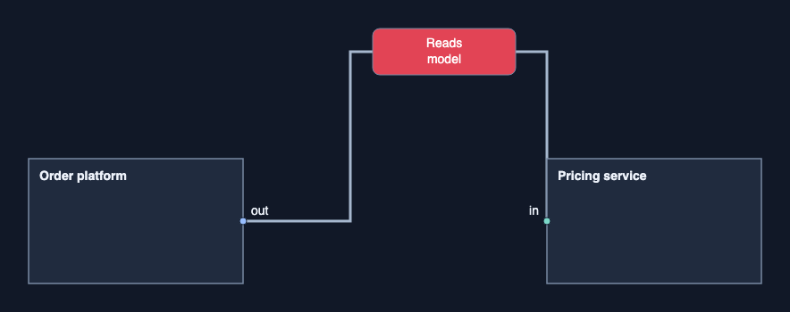

# Retained-layout PNG — local evidence

- result: complete
- claim: retained PNG uses the existing package SVG/PNG path with immutable queued geometry, exact review identity and separate workbench opt-in.
- evidence: regression and installed-consumer tests, root check/typecheck/full tests, production build and real Chromium encoding/download/pixel checks below.
- remaining uncertainty: arbitrary HTML/custom-renderer equivalence, host measurement/key correctness, large-model performance, cross-browser/manual AT and hosted/provider qualification remain unproven.
- next: reconcile remaining D/C/Q parity gates against current APIs and evidence before choosing the next core feature.

## Change and boundary

[ADR 0077](../../../docs/adr/0077-adopt-retained-layout-png.md) records the decision.
The existing PNG context already accepts retained layout through SVG review; this
slice qualifies its browser encoding and adds explicit workbench adoption. Pending
jobs now hold the writer's validated, detached, frozen layout, not the caller's
mutable options. PNG limits are copied. Native SVG precedence, exact expected-SVG
verification, dimension/pixel/byte budgets, loss consent and cancellation remain.

The workbench settings are independently controlled native checkboxes. Both default
off. PNG has an Arrange reason when routes are unavailable. Source/Undo and the
other format's setting are unchanged. Core stays pure and peer-free; browser IO
stays in Commands. No dependencies, wire formats, CLI, provider activation,
publication or deployment change.

## Tests and command evidence

Host-captured local verification:

- Baseline root `bun typecheck` and `bun run check`: exit 0.
- Red regression in `/private/tmp/zloz-png-retained-red.log`: queued input shared
  the caller's layout wrapper before implementation.
- Focused package tests: 7 pass, 76 assertions. Protects independent centre/route
  coordinates, caller mutation after request, exact rebuilt SVG, retained pixel
  overflow, fixed crops, stale layout/key/revision/policy, late completions and cancel. A new protection
  policy may retain an already-reviewed preview while blocking download; it cannot
  publish a pending completion. The fixture explicitly preserves that existing rule.
- Focused workbench SVG/PNG tests: 4 pass, 31 assertions. Independent settings,
  protection, no model/Undo mutation and late completion after disabling PNG.
- Installed Node/Bun and strict TypeScript consumers exercise frozen retained PNG
  input and exact expected-SVG binding from actual package tarballs.
- Final root `bun typecheck`, `bun run check` and `bun run test`: exit 0.
  Existing advisories remain; no warning-free claim.
- Production workbench build: exit 0. `git diff --check`: pass.

Logs: `/private/tmp/zloz-png-retained-{focused,workbench-tests,final-types,final-tests,final-check,demo-build}.log`.
The initial final typecheck found an optional expectedSvg field used without
narrowing in a new test; an explicit assertion corrected the fixture. Initial
browser qualification referenced the source filename rather than the emitted
`browser.mjs` entry; the harness import was corrected. No production fix was
needed for either harness issue. No failures were treated as successful evidence.

## Real browser evidence

[Reproducible script](png-retained-browser.mjs), [machine receipt](png-retained-browser.json),
Chromium 151.0.7922.34:

- Keyboard Space enables the unchecked PNG option and retains focus.
- Missing routes protect Render with a visible Arrange reason.
- Real ELK C4 preview/render/download in light/dark: both actual PNGs 1072×504;
  download bytes equal the preview bytes. Changing source-theme or PNG setting
  invalidates consent and the prior image. SVG remains unchecked independently.
- Working-model/edition lineage exports before/after the setting and theme checks
  are identical.
- Safe vector-badge fixture: light/dark 884×350; transparent 2× output 1768×700.
  Independent expected badge pixel RGBA is exactly `[226, 68, 85, 255]` in all three.
  Transparent output has a zero-alpha background pixel.
- With a 200,000-pixel budget, canonical planning is ready and retained planning
  blocks, because retained bounds enlarge the image. Budget overflow, changed
  expected SVG and stale layout key allocate **zero** image URLs and canvases.
- Real rendered bytes delivered after a changed review or cancellation cannot
  publish an artifact. Page errors/external requests: none.

The badge fixture uses a declared centre envelope and explicit vector adapter,
not arbitrary HTML or a claim that a DOM measurement occurred. Node/state-machine
tests use synthetic completion envelopes; browser checks use real encoded bytes.
Abort/deadline/cleanup machinery is unchanged; this slice tests cancellation of
review authority, not a new native cancellation implementation.

Other artifacts: [transparent 2× badge](png-retained-badge-transparent.png),
[actual light workbench download](png-retained-workbench.png),
[actual dark workbench download](png-retained-workbench-dark-output.png).
The light/dark workbench and badge images were visually inspected. Pixel and
alpha checks qualify the transparent fixture numerically; no screenshot parity
or arbitrary-font/custom-renderer equivalence is claimed.

## Self-review

Architecture/boundary: **safe with noted renderer/browser limits**. No second
rasterizer or request state machine. Source/render identity and custom vector
bounds still require honest host configuration; a capture is not attestation.

Delivery: old canonical defaults remain. Opting into PNG does not enable SVG.
The exact artifact is reviewed and downloaded; losses remain explicit. No release,
registry, hosted or provider qualification was performed.

Test quality: the original shared-reference regression fails before the fix.
Independent route/box coordinates and pixel counts catch plausible copying,
anchor and budget defects. Stale and cancelled real bytes are rejected by the
production controller. Browser evidence is one local Chromium build, separate
from manual AT and cross-browser qualification. Reviews were self-review; no
independent or delegated agent was used.

Recommendation: **needs review** for the wider D/C/Q roadmap; this approved PNG
slice is ready for local commit.
