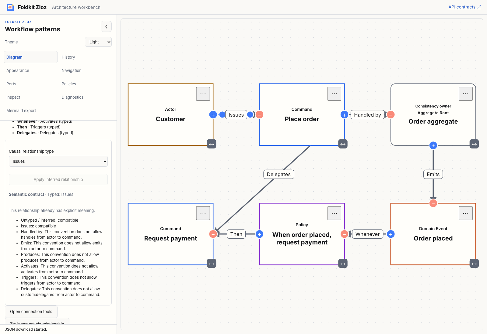
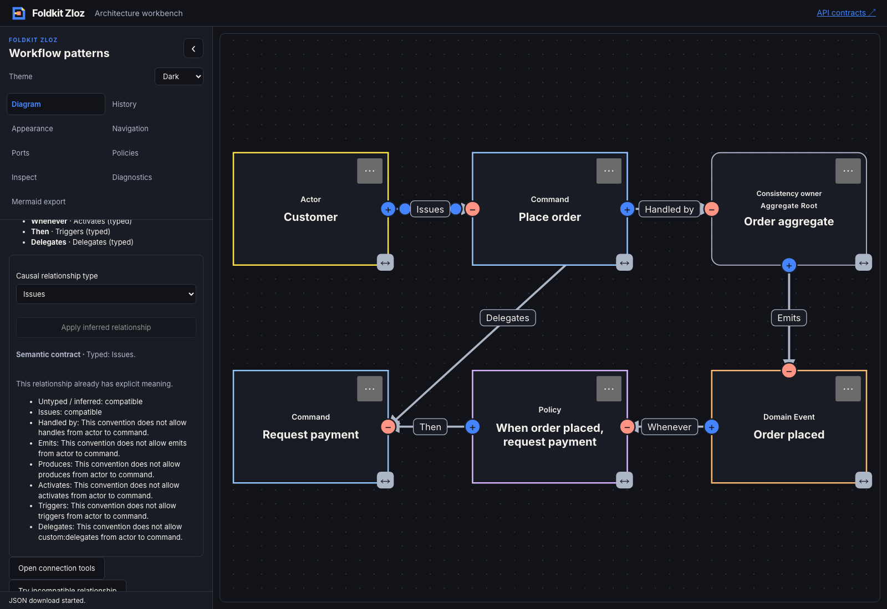

# Composable causal relationship controls — 2026-11-09

- **result:** complete
- **claim:** consumers can compose a package-level relationship chooser and explicit inference action with current-edge identity, fresh convention/policy checks, visible compatibility/availability reasons and customizable native rendering. The workbench uses the public context/resolver and helpers, with scoped host requests and ordinary semantic Undo/Redo.
- **evidence:** baseline and workspace check/typecheck/tests exited 0, including real packed Node/Bun consumers and Bundler/NodeNext type resolution. Eight focused core/rendering tests passed after final helper refinements. All 55 workbench tests and their TypeScript checks passed, including the final canvas integration. Production demo and API documentation builds passed. The [Chromium transcript](relationship-controls-browser.json) confirms unknown stored values remain selected without rewriting metadata, catalogue restoration enables explicit inference, repeated inference is disabled, custom descriptors survive Undo/Redo, and validation-off drafts stay editable. It also verifies the canvas is clear while the inspector is visible and connection tools remain available in Ports. Final light/dark captures were inspected; no page errors occurred.
- **remaining uncertainty:** local qualification only. Existing workspace warnings/skips remain. Native checks are not comprehensive assistive-technology acceptance. Hosts own callback lifetime and must supply current target/conventions/policy; a ready event is not a lasting permission grant. No benchmark, whole-model audit, hosted CI, deployment, npm publication or new portable format is claimed.
- **next:** a package-level causal relationship audit with Effect CLI JSON diagnostics, so agents can inspect complete models without opening the workbench. Recommendation: **needs review**.

[ADR 0031](../../../docs/adr/0031-compose-causal-relationship-controls.md) records the boundary. Core derives choice, inference, status and reason contexts from current graph truth. It ignores changed inspector targets and unknown keys, preserves unavailable stored values, keeps named custom keys distinct and blocks ambiguous inference. Selecting the same key cannot erase authored descriptions. Compatibility information stays separate from enforcement; read-only/gesture/host restrictions remain effective even without a convention policy.

The optional Foldkit entry exposes native select/inference/status/reason helpers plus nullable slots and layout composition. The workbench demonstrates native custom wrappers, button presentation and a semantic status badge. Its adapter rechecks model identity, projection epoch, the current selected edge and current busy/policy state before calling the ordinary editor event path. No duplicate draft, private policy engine, timer, generated ID or persistence schema is introduced.

Architecture, delivery and test-quality reviews are **self-review**. Initial tests failed on missing public exports. Rendering qualification added explicit server-rendered option selection. The SSR assertion checks selected markup for unavailable options; Chromium separately verifies the actual native value. The initial visual capture exposed an existing floating toolbar overlapping the diagram. Final integration uses the public edgeToolbar option to suppress it only while the semantic inspector is visible, with an explicit route to Ports; browser checks confirm both paths. Unrelated untracked files were preserved.

