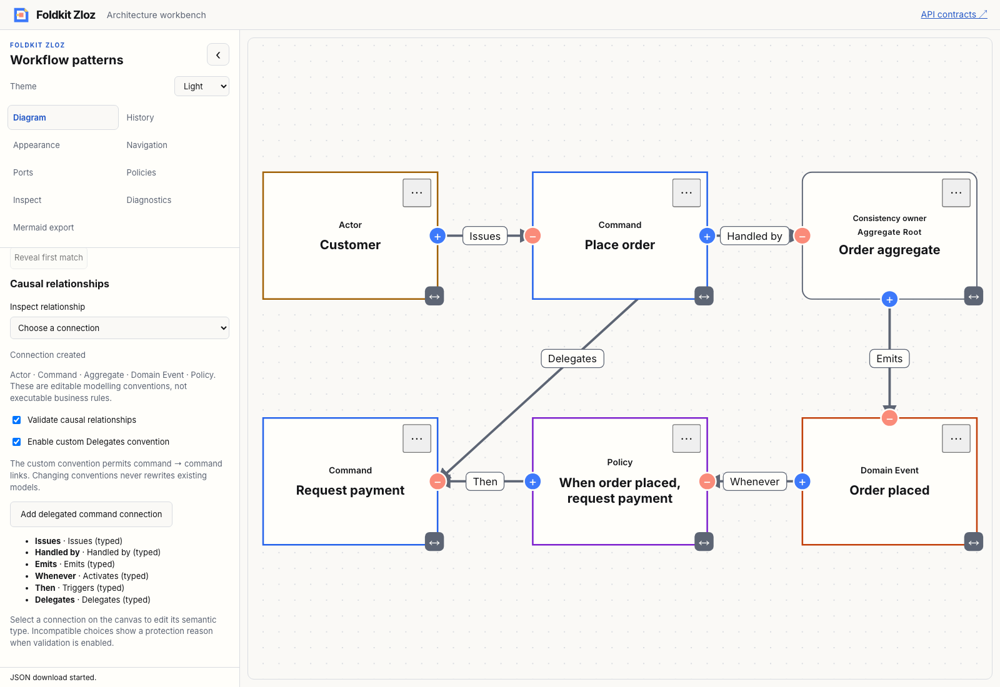
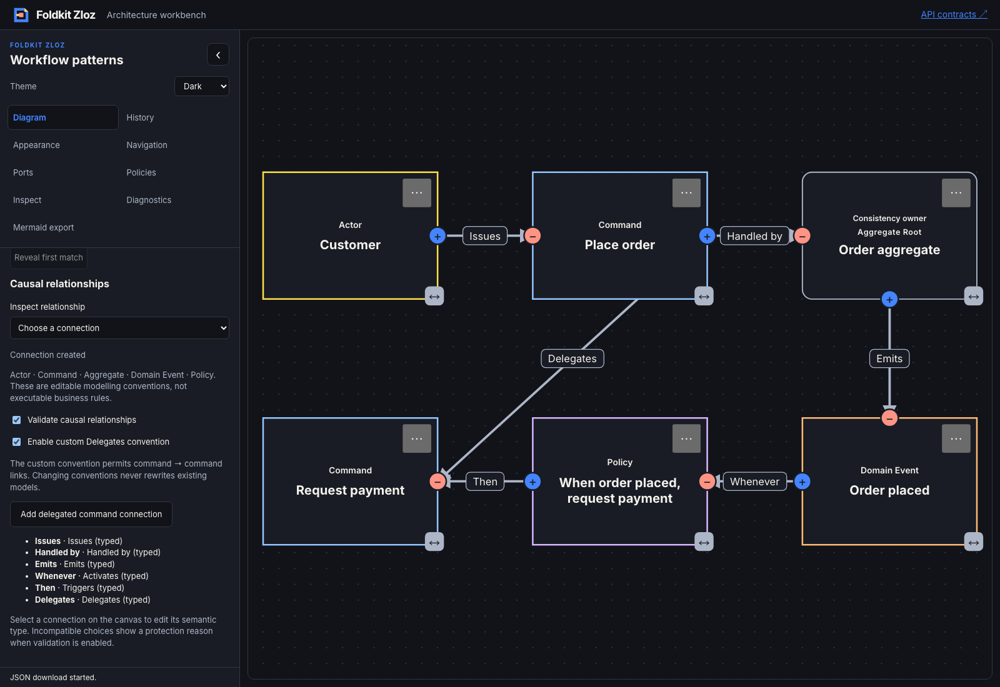

# Typed event-storming causal relationships — 2026-11-09

- **result:** complete
- **claim:** core package users can author typed causal edge meaning, replace process conventions with named custom rules, resolve compatibility with readable reasons and opt into composed editing policies. The workbench demonstrates an aggregate process, custom Delegates links, explicit inference and unresolved drafts without bypassing editor protections.
- **evidence:** baseline and workspace check/typecheck/tests exited 0; six focused core tests cover syntax, inference, ambiguity, custom role interpretation, policy precedence, creation/reconnection, semantic history and Undo/Redo. All 52 workbench tests passed. Real packed Node/Bun consumers and Bundler/NodeNext TypeScript resolution qualified the public contract. Mermaid tests confirm explicit semantic-loss reporting and strict rejection. Production demo/API builds passed. The [Chromium transcript](relationships-browser.json) verifies visible rejection reasons, custom typed creation, Undo/Redo, native disabled options, validation-off drafts, explicit inference and exported descriptors. Light/dark screenshots were inspected.
- **remaining uncertainty:** local qualification only. Existing warnings/skips remain. This is a bounded Zloz vocabulary, not complete EventStorming methodology or an executable process. Native checks do not constitute comprehensive assistive-technology acceptance. Conventions remain host configuration; imports and Undo/Redo preserve snapshots rather than enforce newly selected conventions. Mermaid cannot roundtrip edge architecture and reports that loss. No benchmark, hosted CI, deployment or npm publication is claimed.
- **next:** package-level composable relationship controls with a typed chooser and explicit inference action, making the workbench's semantic editing workflow reusable with host-owned presentation. Recommendation: **needs review**.

[ADR 0030](../../../docs/adr/0030-type-event-storming-causal-relationships.md) separates strict reserved descriptor syntax from optional compatibility rules. Built-in relationships use stable semantic keys; named custom roles, complete replacement catalogues and node-role interpretation are typed extension points. Labels and host data remain independent. Ambiguous inference requests require an explicit choice. Ordinary untyped graphs remain unrelated when neither endpoint participates.

The policy factory composes host vetoes, preserving port direction/locks, duplicate detection, read-only/gesture guards and reconnection policy. It protects edge metadata and incident node-role edits. EdgeArchitectureChanged is a graph transaction with one Undo entry, property-order-independent no-op equality and retained routes. Snapshot/model envelopes remain v1. The compact starter retains five notes with typed links; the detailed factory adds a DDD aggregate root in a two-row process.

The workbench uses the package resolver and policies, includes globally discoverable policy switches independent of artwork, reports typed/inferred/unresolved meaning, and routes edits through the standard scoped Foldkit update path. Native choices expose unavailable options with reasons; disabling validation deliberately allows unresolved drafts. No model metadata is rewritten on convention toggles.

Architecture, delivery and test-quality reviews are **self-review**. Initial tests failed on missing exports. Type qualification corrected an optional-value fixture assertion and nullable notice assertion. The initial browser assertion encountered a generic matcher mismatch for an option that Chromium exposed as disabled; final qualification checks the native disabled property directly and passed. Unrelated untracked files were preserved.

