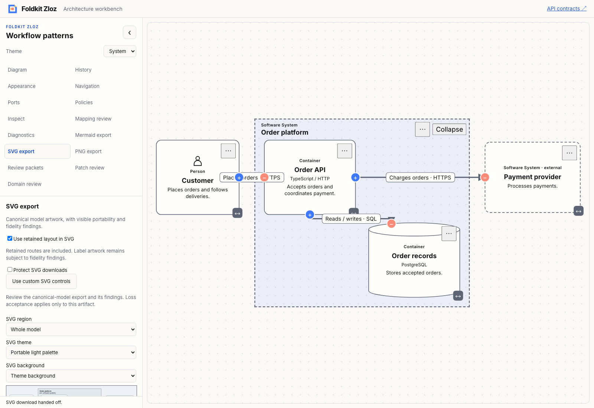
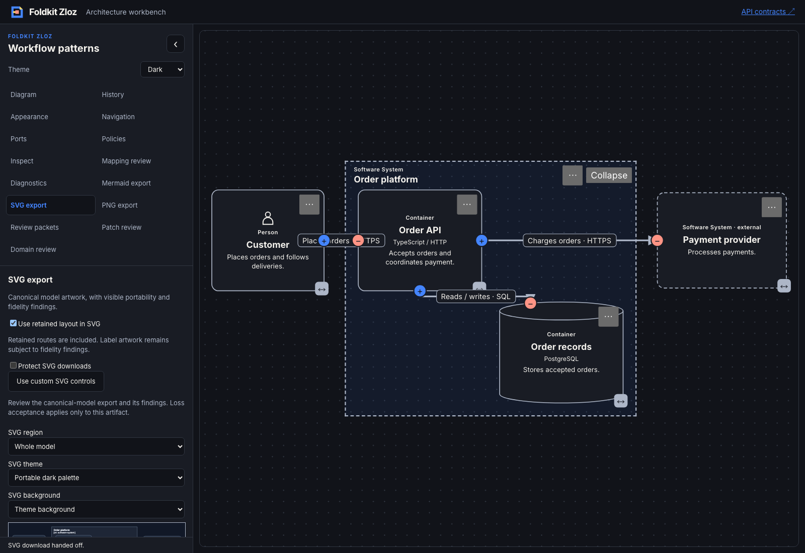
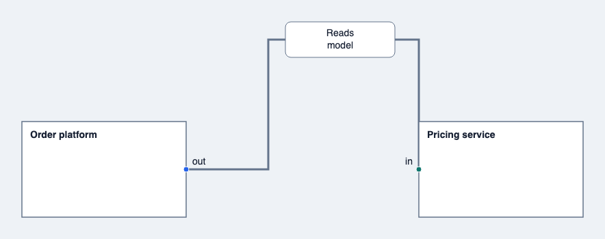
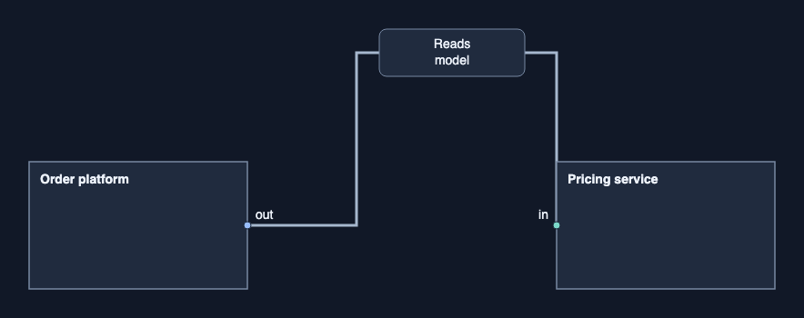

# Retained-layout SVG writer — local verification

- result: complete
- claim: package SVG writing and review consume validated retained paths/label anchors; the workbench offers explicit SVG opt-in while preserving model/Undo and canonical PNG.
- evidence: focused regressions, installed package consumers, root check/typecheck/tests, production build and Chromium emitted-file/download checks below.
- remaining uncertainty: arbitrary HTML/custom-renderer equivalence, font ink/shaping, continuous measurement, PNG opt-in, large-model performance, manual assistive-technology and hosted/provider qualification remain unproven.
- next: adopt retained SVG geometry in opt-in PNG review/encoding with exact-source and pixel-budget evidence.

## Package and workbench changes

[ADR 0076](../../../docs/adr/0076-write-retained-layout-svg.md) extends the prior
planning contract. Core remains browser/Effect independent. The writer reuses the
native geometry resolver and authored waypoint/pathStyle precedence. Effective
route points, centre-anchored label boxes and resolved geometry reach frozen
adapter context. The safe text vocabulary supports validated middle/alphabetic
baseline; no raw markup or path primitive is added. Existing resource, budget,
loss, escaping, clipping and theme behavior remains.

The earlier planner incorrectly interpreted a label centre as a top-left corner.
This slice corrects that bounds union to centre ± half-size and validates finite
extents. Independent coordinate regressions protect the native/ELK convention.
Plain SVG multiline labels use middle baseline and 1.25em line spacing about the
centre. This does not reproduce arbitrary badge HTML, wrapping or font ink.

Optional package review context includes the exact layout in existing consent and
download identity. The unchecked workbench checkbox captures the current main
editor layout only when idle, protects missing routes, and preserves the editor
and Undo object. Workbench PNG requests explicitly receive canonical context. The
existing lower-level PNG APIs share SVG input types; manually supplied retained
options are not PNG/browser-qualified by this slice. No graph wire
format, source model, provider, dependency, CLI or publication changes are made.

## Executed local checks

Host-captured command evidence:

- Baseline `bun typecheck` and `bun run check`: exit 0.
- Red regression: retained writer returned blocked before implementation;
  `/private/tmp/zloz-svg-retained-red.log`.
- Focused planner/writer/review tests: 28 pass, 216 assertions. Independent expected
  path, label centre and model bounds; stale layout, frozen adapter data, authored
  precedence, consent/request invalidation, multiline placement and invalid-baseline
  rejection are covered. Workbench focused tests: 2 pass, 14 assertions.
- Installed tarball consumers exercise retained writing and exported vector context
  under real Node/Bun and strict TypeScript consumer configurations.
- Final root `bun typecheck`, `bun run check` and `bun run test`: exit 0.
  Existing lint/TypeScript advisories remain; no warning-free claim is made.
- `bun run --filter @opsydyn/zloz-demo build`: exit 0.
- `git diff --check`: pass.

Logs: `/private/tmp/zloz-svg-retained-{focused,workbench-tests,final-check,final-types,final-tests,demo-build}.log`.
The first final check required formatting the new browser JSON; it was corrected
and checked again. No production fix was needed for that formatting failure.

## Browser and emitted-file evidence

[Reproducible browser script](svg-retained-browser.mjs) and
[machine receipt](svg-retained-browser.json), Chromium 151.0.7922.34:

- Keyboard Space enables the unchecked native control and retains focus.
- No-route opt-in shows an Arrange reason and protects Download.
- Actual C4 workbench ELK routes match all three native canvas paths in emitted SVG.
- Retained output differs from canonical output. Actual downloaded bytes equal the
  reviewed preview. Graph/edition lineage export before/after the setting/theme
  checks is identical.
- Standalone light/dark SVG documents parse and render without the application.
  Custom vector badge uses frozen route/box context. Tests assert the exact path
  points, centred rectangle position and multiline text position.
- Page errors and external requests: none.

The standalone sample uses an explicitly supplied label envelope, not a claim of
DOM measurement or arbitrary HTML equivalence. It exercises the same transient
centre-anchor contract used by measured native layout labels. Initial browser
assertions read the previous frame immediately after a checkbox event; the final
script waits for the Foldkit-rendered status before reading preview bytes.

Standalone files: [light vector badge](svg-retained-light.svg),
[dark vector badge](svg-retained-dark.svg), [actual workbench download](svg-retained-workbench.svg).
All four captures were visually inspected: controls, canvas and retained badge
placement are readable; no clipping was observed in these fixtures.

## Self-review and recommendation

Architecture/boundary: **safe with noted host-key risk**. Captures and current keys
are freshness inputs, not attestations. Hosts still own recomputation/invalidation,
renderer declarations and custom bounds. Core does not inspect live HTML or perform IO.

Delivery: built-in/canonical defaults remain; opt-in is SVG-only in this host.
Custom declarations and semantic/plain-artwork losses remain visible and require
existing exact-artifact consent. The preview is the downloadable artifact.

Test quality: original writer rejection demonstrates regression detection.
Independent numeric anchors/bounds catch top-left/centre errors; route path,
precedence, stale consent and adapter-freezing assertions catch plausible defects.
Existing writer tests cover resources, budgets and atomic failure. Browser proof
is local Chromium evidence, not manual AT, cross-browser or provider qualification.
No independent reviewer or delegated agent was used.

Recommendation: **needs follow-up** for PNG adoption; this approved SVG slice is
ready for local commit. Nothing has been pushed, published or deployed.
