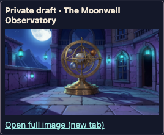
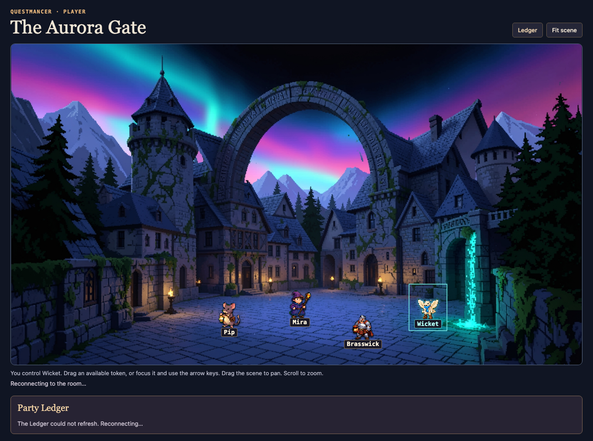
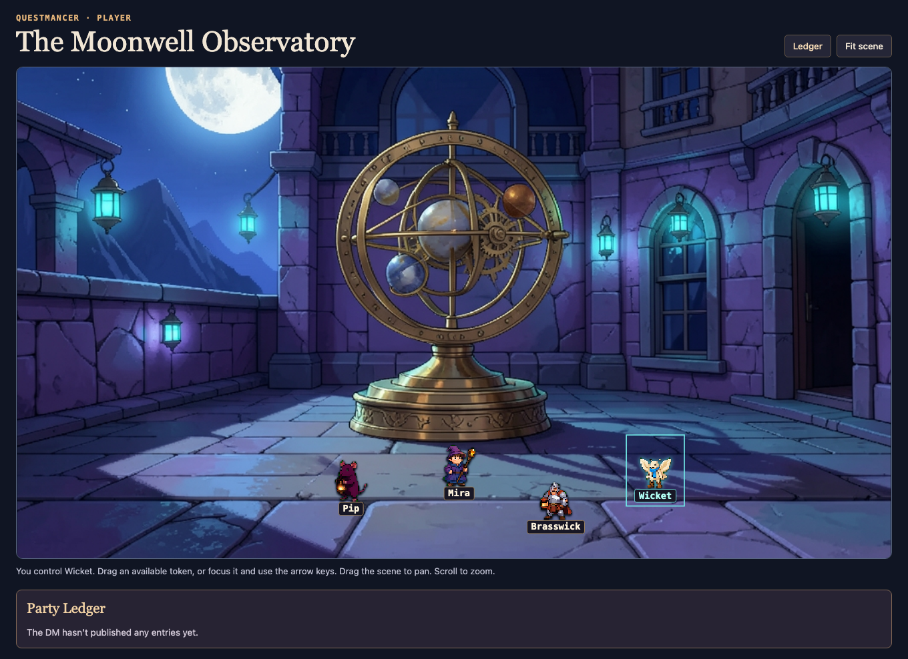
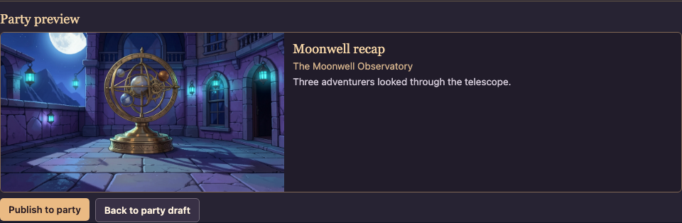
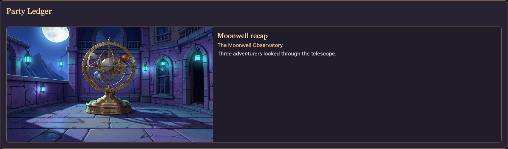

# Moonwell room WebSocket playtest

Local Alchemy and Chromium run on 21 November 2026 at code commit `8f74ae6d`.
One DM and three players used separate browser contexts. The run used
synthetic Teams accounts and sample art.

- All four browsers made zero room or Party Ledger state reads during 12 idle seconds.
- Mira and Brasswick saw the reveal live. Wicket disconnected before the reveal and
  caught up on reconnect without a page reload.
- Player WebSocket frames carried room and published Ledger notices. Preparing the
  private backdrop and saving DM notes emitted no player notices.
- The removed player’s next state read was denied, and the browser cleared the room.

## Screenshots

The DM preview before reveal.

Wicket’s view during the forced disconnect.

Wicket’s room view after reconnect.

The DM reviews the party entry before publishing.

The published entry in Wicket’s Party Ledger.

