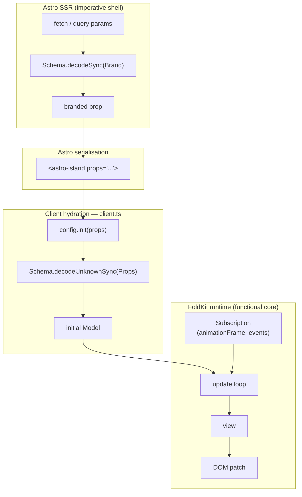

# @opsydyn/astro-foldkit

Astro integration and renderer for [FoldKit](https://foldkit.dev), with
islands that can pre-render, and an opt-in server-rendered page path.

FoldKit is an Elm Architecture runtime built on [Effect](https://effect.website). This package registers FoldKit as an Astro renderer so you can drop any FoldKit app into a `.astro` page as a component, and choose per island whether and when it ships JavaScript.

There are two deliberately separate entry paths:

- `lazyApp` / `defineApp` registers an island. By default Astro receives a deterministic empty mount shell and FoldKit starts in the browser. With `{ prerender: true }` the island's first render is in the HTML, so it can ship with no directive and no JavaScript, or hydrate later with `client:visible` or this package's `client:interaction`. See [Choosing when JavaScript runs](#choosing-when-javascript-runs).
- `definePage` opts one FoldKit application into SSG or request SSR. The server emits FoldKit HTML and public Flags, and `client:load` hydrates that exact DOM.

## Installation

For coding agents, the independent
[astro-foldkit skill](https://github.com/opsydyn/fold-kit-experiments/tree/main/skills/astro-foldkit)
includes consumer guidance and a standalone island/SSG example. Install the
complete skill folder through your agent host; it is separate from this npm
package and does not require the Viz skill.

```sh
npm install @opsydyn/astro-foldkit
# peer deps
npm install astro foldkit
```

## FoldKit compatibility

`@opsydyn/astro-foldkit` targets FoldKit `0.170.x`, Effect `4.1.x`, and the
matching `@foldkit/vite-plugin` `0.29.x` line. An application on an older FoldKit
needs an older release of this integration.
Applications can define interruptible work with
`Command.define(name, { interrupt: true, ... })` inside their own update loop;
this integration continues to own Astro rendering, hydration, and lifecycle
event delivery.

## Setup

Add the integration to `astro.config.ts`:

```ts
import { defineConfig } from 'astro/config';
import foldkit from '@opsydyn/astro-foldkit';

export default defineConfig({
  integrations: [foldkit()],
});
```

FoldKit generates one public build identity for the coordinated client and server
artifacts. The integration uses that compiled identity by default, including
Astro's prerender and Cloudflare environments. Astro continues to own the HTML
document, assets, and deployment adapter; do not enable the standalone FoldKit
`ssr.build` pipeline inside this integration.

For separately built artifacts, supply the same deployment-specific
`FOLDKIT_BUILD_ID` environment variable to every build, or configure
`foldkit({ server: { buildId: 'release-unique-deployment-id' } })`. The ID appears
in public HTML, so it must not contain secrets. Do not reuse it across deployments
with different rendering inputs. Blank `server.buildId` options are rejected, and FoldKit
fails closed when neither a compiled identity nor an explicit override is available.

See the [FoldKit 0.170 release notes](../../docs/releases/foldkit-0.170.md) for
the move to Effect 4.1, and the [0.167 migration guide](../../docs/migrations/foldkit-0.167.md)
for the earlier subscription API changes.

## Defining an app

Use `lazyApp` to register a FoldKit app for lazy loading. The literal loader keeps each Astro island as an explicit code-splitting boundary; it returns your `main.ts` module, which must export a value that satisfies `AppConfig`. `defineApp` remains available as a backwards-compatible alias.

```ts
// src/apps/counter/app.ts
import { lazyApp } from '@opsydyn/astro-foldkit/define-app';

export default lazyApp(() => import('./main'));
```

```ts
// src/apps/counter/main.ts
import { Schema } from 'effect';
import type { Document, HtmlBuilder } from 'foldkit/html';

type Message = 'Inc' | 'Dec';

// `Model` is a runtime Schema, not a plain value: FoldKit reads `Model.ast`
// while the island hydrates. A non-Schema `Model` type-checks, because the
// contract types it as `unknown`, then fails at hydration.
export const Model = Schema.Number;
export type Model = typeof Model.Type;

export const init = () => ({ model: 0 });
export const update = (model: Model, message: Message) => ({
  model: message === 'Inc' ? model + 1 : model - 1,
});
export const view = (model: Model, h: HtmlBuilder<Message>): Document => ({
  title: `Counter: ${model}`,
  body: h.button([h.OnClick('Inc')], [String(model)]),
});
```

A string-union `Message` keeps this example small. Applications with more than a
couple of messages should use `defineMessageUnion` from `foldkit/message`, as
the [astro-foldkit skill](../../skills/astro-foldkit) and the demo apps do.

Use the app in an Astro page:

```astro
---
import Counter from '../apps/counter/app'
---
<Counter client:load noMeta />
```

`noMeta` keeps the island from writing `document.title` on every render tick,
which is what you want whenever the Astro page owns its own title — in
particular on any page carrying more than one island. Drop it only when this
island is meant to own the page title. See [`noMeta`](#nometa).

For `lazyApp` / `defineApp`, the server renderer emits a deterministic
`<div data-foldkit-island="true"></div>` mount shell. Unless the island opts
into [pre-rendering](#pre-rendered-islands-opt-in), it does not load or execute
the FoldKit application during SSR; the application is loaded and embedded only
by the client renderer. Astro still owns the outer island serialisation and
client directive behavior.

In development the integration also adds every module that imports
`define-app` or `define-page` to Vite's dependency scan, so an island's
dependencies are bundled when the dev server starts rather than on the first
request that loads it.

### Pre-rendered islands (opt-in)

An island can put its first paint in the HTML:

```ts
import { lazyApp } from '@opsydyn/astro-foldkit/define-app';

export default lazyApp<Props>(() => import('./main'), { prerender: true });
```

The server then loads the module and runs `init` and `view` over the props
Astro already serialises, filling the same mount shell instead of leaving it
empty. The markup is static. Nothing hydrates it, and the client replaces it on
boot exactly as it replaces an empty mount; because both sides run the same
pure `init` and `view` over the same props, the replacement is the same markup.

It carries no hydration stamp and no Flags payload, so any number of
pre-rendered islands may share one document — unlike a `definePage` owner, of
which a document may hold one. No build identity is involved, and no Astro
request context is read.

Two consequences are worth knowing:

- `init` and `view` run on the server. An island whose `init` touches a
  browser-only resource must leave this off. Opting in and failing fails the
  render rather than quietly falling back to the empty mount, because an author
  who asked for markup should be told they did not get it.
- `client:visible` only works for an island that opts in. Astro's directive
  observes an island's children, because `astro-island` is `display: contents`;
  an empty mount measures 0x0 and never intersects, so the island silently
  never hydrates. A pre-rendered island has size, and the directive works.

### Choosing when JavaScript runs

Pre-rendering separates two decisions that used to be one: whether an island
appears in the HTML, and whether it ships JavaScript. Make them per island.

| Island needs                | Write                                             | JavaScript at load           |
| --------------------------- | ------------------------------------------------- | ---------------------------- |
| To be read, never touched   | `prerender: true`, **no directive**               | none for this island         |
| Interaction, below the fold | `prerender: true`, `client:visible`               | none until it is scrolled to |
| Interaction, by a few       | `prerender: true`, `client:interaction`           | none until it is touched     |
| Interaction, immediately    | `prerender: true`, `client:load` or `client:idle` | the runtime, at load         |
| A browser-only `init`       | no `prerender`, `client:load` or `client:idle`    | the runtime, at load         |

An island with no directive is Astro's ordinary static component: Astro emits
no `<astro-island>` element and no script, so a pre-rendered FoldKit chart with
no directive is complete HTML and nothing else. Most charts in a report are
never interacted with, and this is how they should ship.

One thing decides how much any of this saves: **the FoldKit runtime is shared,
so one island that hydrates at load pays for all of it.** Making three of four
islands static saves their own chunks and serialised props, not the runtime the
fourth still needs. The large win comes when _nothing_ on the page hydrates at
load. The pattern that gets there is to pre-render everything, leave the
readable islands without a directive, and give the one interactive island
`client:visible` if it sits below the fold.

Measured on a report page with three charts and a data grid over 7,729 rows:

| Configuration                                                 | JavaScript at load   | After scrolling to the grid |
| ------------------------------------------------------------- | -------------------- | --------------------------- |
| Four islands, `client:load`                                   | 377 KB, 17 requests  | —                           |
| Three charts static, grid `client:load`                       | 351 KB, 8 requests   | —                           |
| Everything pre-rendered, charts static, grid `client:visible` | **0 KB, 0 requests** | 351 KB, 8 requests          |

In the last configuration the whole report, the grid's first page included,
renders before any JavaScript runs. A chart that loses its hover readout by
going static can keep the information as a native SVG `<title>` on each mark,
which the browser shows as a tooltip and which costs no runtime.

#### Module preloads for islands that boot at load

An island's JavaScript arrives as a chain: Astro's bootstrap fetches the
renderer and the component module, the component's `load` imports the
application, and each chunk reveals its own imports only once it arrives.
Astro emits no preload hints for island chunks, so every link costs a round
trip.

For each pre-rendered page, the build adds a `<link rel="modulepreload">` at
the end of `<head>` for every chunk a `client:load` or `client:only` FoldKit
island needs to boot, so the browser fetches the chain in parallel. The links
follow the stylesheets, so they do not compete with render-blocking CSS. What
the application imports lazily stays lazy, and islands that defer their
download (`client:visible`, `client:idle`, `client:interaction`,
`client:media`) are left alone, as are other renderers' islands. Nothing needs
configuring.

On a server-rendered report page whose owner hydrates with `client:load`, at
150 ms per request, this cut the time to hydration from 1,140 ms to 510 ms, five
sequential round trips down to two, with first paint unchanged.

Pages rendered on request are not on disk at build time and keep the chain.

#### `client:interaction`

The integration adds a `client:interaction` directive. It hydrates a
pre-rendered island on the reader's first pointer press, focus or key press
inside it, and replays what they did before it booted:

```astro
<Counter client:interaction />
<Counter client:interaction={{ hover: true }} />
```

FoldKit renders an island fresh rather than adopting the pre-rendered markup,
so without help the click that started the download would be lost, and text
typed into the static markup would disappear in the swap. The directive records
clicks, field edits and focus inside the island, in order, and replays them
onto the matching elements of the first client render: a field edit arrives as
`input` and `change` events, a click as a click, and focus and the caret are
restored. Elements are matched by position, which holds because server and
client run the same pure `init` and `view`. A step whose element has changed,
or is now disabled, is skipped. A run of edits to one field replays as its
final value. With `{ hover: true }` a mouse pointer over the island also starts
the download, which usually finishes before the click.

The pre-rendered markup never reacts, so replay is faithful only up to the
first point where the application would have changed the DOM. Typing into a
field, pressing a button that clears it, then typing again replays the button
press correctly but leaves the field holding everything typed.

Choose it over `client:visible` only when most readers who see the island never
use it, and its controls work in the pre-rendered markup. Every interaction
waits for the download first. On the report page above, under Slow 4G and a
4× CPU slowdown on a phone viewport, the grid's search was usable 1.65 s after
the tap with `client:interaction`, against immediately with `client:visible`,
which had already spent 172 KB while the reader scrolled. That grid also keeps
its controls disabled until its rows arrive, so the reader's first tap does
nothing but start the download: `client:visible` is the better choice there.

The renderer warns at build and dev time about the arrangements that misbehave
without an error, each once per component:

- an island with **no directive and no `prerender`** renders an empty mount and
  ships nothing, so it never displays anything;
- an island with **`client:visible` and no `prerender`** never intersects, for
  the reason above, so it never hydrates;
- an island with **`client:interaction` and no `prerender`** has no markup to
  interact with, so it hydrates at once, as `client:load` would.

FoldKit replaces the inner mount, not the outer `<astro-island>`. The outer
element remains Astro's lifecycle owner, including for empty `client:only`
hosts, where the client renderer creates an inner mount. Nested islands keep
their own mounts.

The demo app's [`/request-diagnostics`](../../apps/web/src/pages/request-diagnostics.astro) page shows the integration boundary with a practical machine-driven chart workflow. The page uses `@opsydyn/astro-foldkit` for hydration, `@opsydyn/foldkit-viz` for chart primitives, and `foldkit/experimental/machine` in the application update layer.

The [`/comparison`](../../apps/web/src/pages/comparison.astro) example hosts
dynamic scatter/histogram panels using the same `lazyApp` island contract.
Stable panel IDs, `foldChildAt`, linked selection, measurements and focus policy
belong to the application. Astro provides hydration and lifecycle facts only;
no additional integration API or server-rendering opt-in is required. The promo
hosts the maintained workbench with source inspection and standalone exports.

## Server-rendered pages (opt-in)

Use `definePage` when one FoldKit application owns the document content for an
Astro route. It is intentionally separate from `lazyApp`: existing apps and
charts remain client-only islands unless they are explicitly migrated.

The page loader has the same literal lazy-module shape as `lazyApp`, but its
Flags factory is synchronous and receives request facts from Astro:

```ts
// src/apps/greeting/page.ts
import { definePage } from '@opsydyn/astro-foldkit/define-page';
import { Match, Schema } from 'effect';

import { Flags, type Locale, type Name } from './model';

type Props = { readonly name: Name };

const localeFromUrl = (url: URL): Locale =>
  Match.value(url.searchParams.get('locale')).pipe(
    Match.when('ar', () => 'ar' as const),
    Match.when('en', () => 'en' as const),
    Match.orElse(() => 'en' as const),
  );

export default definePage<Props, Flags>(() => import('./main'), {
  flags: ({ props, url }) =>
    Schema.decodeSync(Flags)({
      name: props.name,
      locale: localeFromUrl(url),
    }),
});
```

The loaded `main` module exports the page configuration, including the runtime
`Flags` Schema/value used by FoldKit to validate the serialized handoff:

```ts
// src/apps/greeting/main.ts
import { Message } from './message';
import { Flags, init, Model } from './model';
import { update } from './update';
import { view } from './view';

export { Flags, init, Message, Model, update, view };
```

`Flags` must be public JSON-serializable data required to create the first
Model. The factory may derive it from `request`, `url`, `params`, and validated
component `props`, but it must not return secrets, credentials, request bodies,
or runtime objects. It must not run Commands, Subscriptions, remote loads, or
browser-only resources. Server rendering is a deterministic render handoff,
not a server data-loading abstraction.

### Request SSR

Resolve the same page document in the Astro frontmatter so its FoldKit metadata
can reach the outer layout. Keep the resolver import server-only:

```astro
---
export const prerender = false;

import { Schema } from 'effect';
import { resolvePageDocument } from '@opsydyn/astro-foldkit/server';

import GreetingPage from '../apps/greeting/page';
import { Name } from '../apps/greeting/model';
import Layout from '../layouts/Layout.astro';

const name = Schema.decodeSync(Name)(Astro.url.searchParams.get('name') ?? 'astronaut');
const document = await resolvePageDocument(GreetingPage, {
  request: Astro.request,
  url: Astro.url,
  params: Astro.params,
  props: { name },
});
---

<Layout
  title={document.title}
  lang={document.lang}
  dir={document.dir}
  canonical={document.canonical}
  ogUrl={document.ogUrl}
>
  <GreetingPage client:load name={name} />
</Layout>
```

The layout owns the outer `<html>` structure and applies `title`, `lang`,
`dir`, `canonical`, and `ogUrl` from the resolved FoldKit `Document`. The
`client:load` directive is still required for an interactive page: the server
HTML contains one stamped FoldKit root and the browser hydrates that exact root
with the serialized Flags payload.

### Canonical metadata

`definePage` does not infer a canonical URL from `Astro.url`, route parameters,
or the browser location. The page view must return `Document.canonical` when the
application has a canonical identity. Query parameters and alternate
representations remain application-owned. When FoldKit supplies the 0.165
canonical-to-`ogUrl` fallback, the resolver passes it through unchanged.

### SSG

The same page owner can be prerendered when its props and Flags are universal:

```astro
---
export const prerender = true;

import { Schema } from 'effect';
import { resolvePageDocument } from '@opsydyn/astro-foldkit/server';

import GreetingPage from '../apps/greeting/page';
import { Name } from '../apps/greeting/model';
import Layout from '../layouts/Layout.astro';

const name = Schema.decodeSync(Name)('static astronaut');
const document = await resolvePageDocument(GreetingPage, {
  request: Astro.request,
  url: Astro.url,
  params: Astro.params,
  props: { name },
});
---

<Layout
  title={document.title}
  lang={document.lang}
  dir={document.dir}
  canonical={document.canonical}
  ogUrl={document.ogUrl}
>
  <GreetingPage client:load name={name} />
</Layout>
```

An SSG error fails the build. A request-SSR error reaches Astro's error
response. The integration does not replace failed page rendering with the
client-only shell. A document may have only one `definePage` owner; use
`lazyApp` / `defineApp` for additional charts or embedded applications.

`noMeta` remains an island-only option for `defineApp`. It does not change the
page-owner metadata contract.

## Passing props

`lazyApp` accepts a type parameter for the props your FoldKit app expects. This makes the component callable with typed attributes in `.astro` files.

```ts
// src/apps/greeting/app.ts
import { lazyApp } from '@opsydyn/astro-foldkit/define-app';
import type { Name } from './model';

export default lazyApp<{ name: Name }>(() => import('./main'));
```

Props are forwarded from Astro's `<astro-island>` serialisation into your `init` function. Declare `init` to accept `props: unknown` and validate at the boundary with Effect Schema:

```ts
// src/apps/greeting/model.ts
import { Schema } from 'effect';

export const Name = Schema.String.pipe(Schema.brand('Name'));
export type Name = typeof Name.Type;

const Props = Schema.Struct({ name: Name });

export const init = (props: unknown): { readonly model: Model } => {
  const { name } = Schema.decodeUnknownSync(Props)(props);
  return { model: name };
};
```

Pass the branded value from the Astro page:

```astro
---
import { Schema } from 'effect'
import GreetingApp from '../apps/greeting/app'
import { Name } from '../apps/greeting/model'

const name = Schema.decodeSync(Name)(Astro.url.searchParams.get('name') ?? 'World')
---
<GreetingApp client:load name={name} />
```

The TypeScript types flow end-to-end: the `Name` brand is required at the Astro call site, and `Schema.decodeUnknownSync` re-validates the serialised value at the client hydration boundary.

## Built-in props

The renderer intercepts one reserved prop before forwarding anything to your app. It is never seen by `init`, `update`, or `view`.

### `noMeta`

Prevents the FoldKit program from overwriting `document.title`. Use this whenever you embed an app as an island on a page that manages its own title — without it, the island's view tree will update the browser tab title on every render tick.

```astro
<DashboardChart client:load noMeta data={chartData} />
```

Both `noMeta` and `noMeta={true}` are accepted. The wrapper pins only the
Document `title`; FoldKit still applies `lang` and `dir` from the app's current
Document.

`noMeta` is declared on the default `EmptyProps`. Supplying your own `Props` to
`lazyApp<Props>` replaces that type, so re-declare the prop to keep the opt-out
available:

```ts
// src/apps/chart/app.ts
import { lazyApp } from '@opsydyn/astro-foldkit/define-app';

import type { ChartProps } from './main';

type Props = ChartProps & { readonly noMeta?: boolean | '' };

export default lazyApp<Props>(() => import('./main'));
```

Without it, `<Chart client:load noMeta />` fails to type-check with
`Property 'noMeta' does not exist`.

## Architecture

`definePage` owns one server-rendered FoldKit application for a document;
`lazyApp` / `defineApp` owns an independent client island. The integration does
not infer page ownership from ordinary app markers, and adding `definePage`
does not migrate existing chart routes.

### Imperative shell, functional core

The Astro page is the **imperative shell**: it performs side effects (HTTP fetches, query-param reads, URL parsing) and validates raw values into branded types via `Schema.decodeSync`. The shell hands only clean, typed values into the component.

The FoldKit app is the **functional core**: its `init`, `update`, and `view` functions are pure. They receive already-validated props, run a closed message loop, and produce a view tree — with no side effects outside of declared `Command`s and `Subscription`s.

### Data flow



The double-decode is intentional: `Schema.decodeSync` at the Astro boundary ensures the page cannot render with invalid data; `Schema.decodeUnknownSync` at the FoldKit boundary re-validates after JSON round-trip through the island serialisation, so the functional core never receives unverified input.

## AppConfig

The module returned by your loader must export:

| Export   | Type                                                                      | Description                                   |
| :------- | :------------------------------------------------------------------------ | :-------------------------------------------- |
| `Model`  | `unknown`                                                                 | Initial model type marker                     |
| `init`   | `(props: unknown) => { model: Model; commands?: ReadonlyArray<Command> }` | Initial state from props and startup commands |
| `update` | `(model, message) => { model: Model; commands?: ReadonlyArray<Command> }` | Pure state transition                         |
| `view`   | `(model, h: HtmlBuilder<Message>) => Document`                            | Render with the current render-frame builder  |

For `definePage`, `init` receives the validated `Flags` value rather than raw
Astro props, and the module must additionally export the runtime `Flags`
Schema/value. `defineApp` keeps the existing props-based `init` contract.

## Exports

| Entry point                          | Description                                               |
| :----------------------------------- | :-------------------------------------------------------- |
| `@opsydyn/astro-foldkit`             | Default Astro integration (`foldkit()`)                   |
| `@opsydyn/astro-foldkit/define-app`  | `lazyApp` helper (`defineApp` alias) and `AppConfig` type |
| `@opsydyn/astro-foldkit/define-page` | `definePage`, `PageConfig`, and page Flags context types  |
| `@opsydyn/astro-foldkit/server`      | Server-only `resolvePageDocument` metadata resolver       |

The root entry point also exports the `InteractionOptions`, `NavigationConfig`,
`NavigationEvent`, and `NavigationPhase` types, and declares the
`client:interaction` directive on Astro's `AstroClientDirectives`.

## Embedding

`Runtime.embed` gives you a typed handle to the running program so you can clean it up on unmount and push live data in without remounting. This integration uses `embed` internally — the `astro:unmount` event calls `handle.dispose()` to tear down subscriptions and animation-frame loops when Astro navigates away.

### Declaring ports

Ports are typed channels declared in your app's `main.ts`. Pass a `Schema` for each port so values are validated at the boundary.

```ts
// src/apps/dashboard/main.ts
import { Port } from 'foldkit';
import { Schema } from 'effect';

export const ports = {
  inbound: {
    data: Port.inbound(Schema.Array(DataPointSchema)),
  },
  outbound: {
    selection: Port.outbound(Schema.NullOr(Schema.String)),
  },
};
```

### Navigation events

To receive Astro View Transition lifecycle events, declare an inbound port and a mapper in the app configuration. Astro props remain the input to `init`; navigation events are runtime messages delivered through the configured port.

```ts
// src/apps/dashboard/main.ts
import { Schema } from 'effect';
import { Port } from 'foldkit';
import type { NavigationEvent } from '@opsydyn/astro-foldkit';

export const ports = {
  inbound: {
    navigation: Port.inbound(Schema.Unknown),
  },
};

export const navigation = {
  port: 'navigation',
  map: (event: NavigationEvent) => ({
    _tag: 'Navigated' as const,
    ...event,
  }),
};
```

The mapper receives this value shape:

```ts
type NavigationEvent = {
  readonly phase: 'coldLoad' | 'entered' | 'exited' | 'stayed';
  readonly path: string;
  readonly previousPath: string | null;
};
```

The bridge sends `coldLoad` immediately for the first mount of an island identity. A retained island receives `stayed` on `astro:before-swap` when its matching `uid` exists in the incoming document, but does not receive `entered` from the following global `astro:page-load`. A same-identity remount emits `entered` on mount; an active island can also emit `entered` for a later page load when it was not retained. Every mounted island emits `exited` once on `astro:unmount`. Events contain normalized pathnames; route parsing and route-specific message decisions belong in the app mapper. If the configured inbound port is missing, the integration warns once and leaves the FoldKit runtime mounted without forwarding events.

The integration owns only lifecycle observation and port delivery. The app owns parsing `path` into its route type, mapping the event into a past-tense Message, and deciding whether an `entered` event should run a load or revalidation command. Keep that policy in `update` or a FoldKit `Transition`, so SSR props, navigation facts, and side effects remain separate. When an app uses exited to interrupt work, the interrupt key, state, and outcome policy stay in its update loop; the integration does not cancel or replace commands.

### Retained island ownership

When Astro actually retains the same client-island element during navigation,
the integration preserves its running FoldKit Model and resources. Repeated
hydration of that host shares one initialization, including while its module
is loading; it does not call `init` again or start another runtime. Matching a
`uid` for navigation events alone is not a substitute for retaining the DOM host.

Props seed `init` once per live runtime. Changes to Astro's serialized props do
not reseed an active retained island; use app-owned inbound ports for live data.
On genuine `astro:unmount`, the integration detaches its navigation bridge and
disposes the runtime. Unmount during module loading prevents a later detached
mount. Module-load or pure `init` failure releases ownership so hydration can
retry; asynchronous runtime startup failures remain FoldKit-owned.

Remounting the same host starts with fresh props and uses public `Runtime.embed`
sequencing to wait for previous teardown before restarting. The host must still
represent the same app, schemas, ports and update definition. This contract is
for `lazyApp` / `defineApp` islands, not a new retained-navigation guarantee for
`definePage` owners.

Pass the ports map to `makeApplication` alongside your `init`, `update`, and `view`:

```ts
import { Runtime } from 'foldkit';

const program = Runtime.makeApplication({
  Model,
  init,
  update,
  view,
  container,
  devTools: false,
  ports,
});
```

### Live prop updates

Once embedded, push new data through an inbound port instead of remounting the component. This is particularly useful in Astro View Transition flows where the page shell re-runs but the island should preserve its running state:

```ts
const handle = Runtime.embed(program);

// Called when Astro soft-navigates back to this page with new data
handle.ports.data.send(nextDataPoints);
```

### Outbound subscriptions

Subscribe to outbound ports to react to events inside the program from the host page. Port names are flat on `handle.ports` regardless of whether they were declared under `inbound` or `outbound`:

```ts
const unsubscribe = handle.ports.selection.subscribe((id) => {
  // sync selection state to the URL or another island
  history.replaceState({}, '', `?selected=${id ?? ''}`);
});

element.addEventListener(
  'astro:unmount',
  () => {
    unsubscribe();
    handle.dispose();
  },
  { once: true },
);
```

## Peer dependencies

| Package   | Version               |
| :-------- | :-------------------- |
| `astro`   | `≥ 5.0`               |
| `effect`  | `~4.1.0`              |
| `foldkit` | `≥ 0.170.0 < 0.171.0` |

## Stateflow Observatory example

The demo route `/stateflow` uses `StateflowPage`, an app-owned `definePage` entry,
to server-render the graph and current state before hydrating with `client:load`
inside the existing Astro layout. Astro supplies the island and lifecycle facts;
the app owns the Machine, typed inbound replay Port, outbound transition telemetry Port,
replay policy, and trace inspector. The graph consumes plain layout records.

This slice adds no Astro integration API and moves no async work into the
integration. Commands and subscriptions remain app-owned, including telemetry
emission, validation of inbound replay events, and the reduced-motion
`Dom.streamFromMediaQuery` stream in a `Subscription.persistentEntry`. That subscription is the app's
example of FoldKit PR [#1424](https://github.com/foldkit/foldkit/pull/1424): it
records the browser's initial media-query match and subsequent changes, then
lets the Model decide whether visual motion is allowed.

## Remote visual loads

For future remote filter, brush, or zoom loads, construct the refresh step with
an explicit selection snapshot and request ID. `LoadFilteredData` is an
app-owned interruptible Command whose declared args include `selection` and
`requestId`; its `execute` uses those args and returns the ID with its result
Message. Commands do not read the later Model implicitly.

In this example, `Model.data` is `AsyncData<Data, string>`. `Selection`, `Data`,
`Model`, and `Message` are application types. The app also stores the latest
`selection`, a monotonic `nextRequestId`, `routeActive`, and a discriminated
`request` union: `Idle | Running { requestId } | Cancelling { requestId }`.

```ts
import { Option } from 'effect';
import { getData, Idle, revalidateOrLoad, succeed } from 'foldkit/asyncData';
import { refresh } from 'foldkit/update';
import type { Return } from 'foldkit/update';

import { LoadFilteredData } from './command';
import type { Message } from './message';
import type { Data, Model, Selection } from './model';

const loadOnFilter = (selection: Selection, requestId: number) =>
  refresh<Model, Message, Data, string>({
    read: (model) => Option.some(model.data),
    revalidate: revalidateOrLoad,
    write: (model, data) => ({ ...model, data }),
    load: LoadFilteredData({ selection, requestId }),
  });

// Call only when request is Idle and data is not Loading or Refreshing.
const startLatest = (model: Model): Return<Model, Message> => {
  const requestId = model.nextRequestId;
  const next: Model = {
    ...model,
    nextRequestId: requestId + 1,
    request: { _tag: 'Running', requestId },
  };
  return loadOnFilter(next.selection, requestId)(next);
};

// The outcome handler first checks Cancelling and the cancelled request ID.
const afterInterruption = (model: Model): Return<Model, Message> => {
  const next: Model = {
    ...model,
    request: { _tag: 'Idle' },
    data: Option.match(getData(model.data), {
      onNone: () => Idle(),
      onSome: (data) => succeed(data),
    }),
  };
  if (!next.routeActive) return { model: next };
  return startLatest(next);
};
```

Use this explicit **latest-selection wins** policy in the app's update loop:

1. Record every new filter, brush, or zoom selection in `Model.selection`. If
   the route is active and `request` is `Idle`, call `startLatest` with that
   updated Model. While the route is inactive, only store the selection.
2. If a request is `Running`, change it to `Cancelling` with the same request
   ID and return only its keyed interruption Command. Capture that ID in the
   interruption outcome Message. Do not start a replacement in the same batch.
3. While `Cancelling`, keep replacing `Model.selection` with the latest input;
   emit no further load or interruption Commands. Ignore normal result Messages
   for this cancelled request, including a result racing with interruption.
4. For a matching interruption outcome (`Interrupted` or `NotFound`), call
   `afterInterruption` using the current Model. An interrupted Command will not
   send its original result Message. The helper therefore explicitly clears
   pending AsyncData: `Loading` becomes `Idle`, and `Refreshing(data)` becomes
   `Success(data)`. It then starts the latest selection with a fresh ID, moving
   back to `Loading` or `Refreshing`. Calling `refresh` on the old pending state
   would produce no Command because `revalidateOrLoad` returns `None` there.
5. Accept a normal result only when its ID matches the `Running` request.
   Apply `settle(model.data, result)` from `foldkit/asyncData` and set `request`
   to `Idle` in the same update. Ignore stale IDs and duplicate outcomes. Cached
   data retained during replacement still belongs to the previous selection;
   present it as such until the matching replacement result arrives.
6. On route exit, mark the route inactive and interrupt any `Running` request,
   or wait for the existing `Cancelling` outcome. The same outcome handler
   clears pending AsyncData but starts no replacement while inactive. Route
   entry can call `startLatest` from `Idle`; if still `Cancelling`, wait for its
   outcome before loading the latest selection.

The app owns command keys and correlation, interruption/cancellation policy,
AsyncData, and the Model. `refresh` supplies the revalidation step, not that
replacement policy. The app derives the records supplied to `foldkit-viz`,
whose synchronous functions compute geometry; chart primitives cannot fetch
data or subscribe to events or Ports.

Use typed Ports only for host input/output: map validated inbound values to app
Messages and emit outbound values through app-owned Commands. Keep internal
state in the Model and internal event flow in Messages and update. Astro mounts
the island and supplies lifecycle facts; it does not own remote visual loads.

## License

MIT
