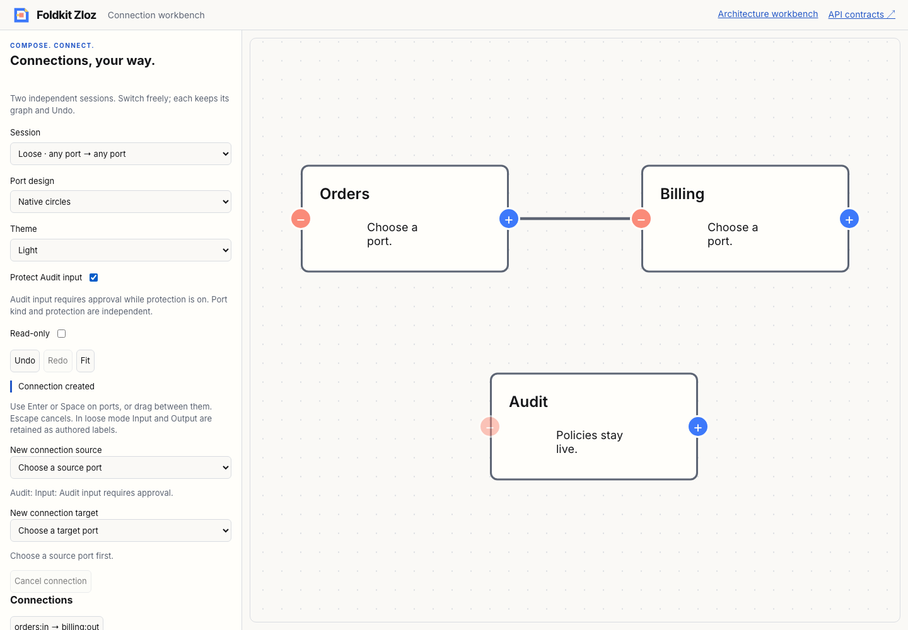
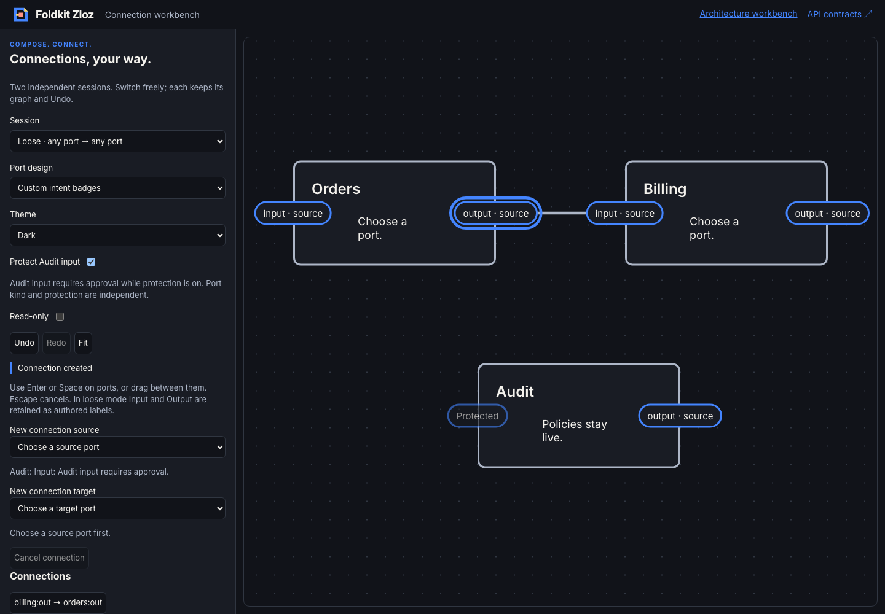

# Native and composable loose-connection qualification

- result: complete
- claim: native wiring and composable port intent follow fixed session mode, preserve current reducer authorization/Undo, and are demonstrated in independent strict/loose workbench sessions.
- evidence: native adapter/rendering/schema tests, workbench session tests, local built-site Chromium checks and light/dark screenshots, plus repository verification below.
- remaining uncertainty: real touch devices, human AT, cross-browser and broader C/Q/R qualification remain open; canonical model/edition and portable adapters have not adopted v2, so C1 remains partial.
- next: define canonical model/edition mode preservation and literal old-reader compatibility before adopting loose sessions in those workflows.

Measured parent: `7c32a272` on isolated branch `codex/zloz-context-map`.
See [ADR 0094](../../../docs/adr/0094-adopt-loose-mode-in-native-port-interactions.md).
Architecture, delivery and test-quality reviews are self-review.

## Boundaries and regressions

The adapter reads the owning surface mode to collect candidates; it never grants
permission. The reducer's own mode, live per-port/end/global policies, duplicate
rules and atomic history remain unchanged. Native drag starts, nearest candidates
and tap release support both authored kinds only when loose. Reconnection retains
strict moving-end filters or loose both-kind candidates. Nested surfaces remain
excluded; points use explicit client coordinates. Native button labels and custom
`connectionEnd` describe source/target activation without rewriting authored kinds.
The preview's moving end remains the reconnection feedback contract.

Retained node layers depend on mode. A distinct view ID keys a distinct canvas
Mount/input binding so callbacks from an old session cannot retain ownership of the
new session's native controls. The existing scoped resource still owns listener,
observer and capture cleanup. The demo scopes events by session and forbids session
or design changes during an active drag; each editor retains independent history.
The shared shell retains the existing architecture workbench and family styling.

Wire release publishes its intent once. The ensuing pointer-generated click is
consumed, while detail-zero keyboard/programmatic activation remains supported.
Consumption resets on the next pointer press; separate deliberate activations can
still request self-connections under current policies. A regression detected the
double activation before this correction. No graph state lives in the adapter.

## Tests and browser evidence

- `test/input.test.ts`: twelve independent cases span mouse/touch, strict/loose and
  creation/source-reconnection/target-reconnection; nearby candidates reject
  incompatible kinds in strict mode, include both kinds in loose mode and exclude
  nested surfaces. Creation cases also assert one tap intent, synthesized-click
  deduplication and separate keyboard activation.
- `test/input-message.test.ts`: explicit source intent survives browser-message
  decoding; unknown intent rejects.
- `test/port-render.test.ts`: native and composed ports retain authored kinds,
  change accessible names/pressed state with pending intent, expose custom intent
  and retain the mode/help contract.
- `apps/zloz-demo/test/connection-workbench.test.ts`: three cases assert independent
  graph/history sessions, delayed foreign-session rejection, live protection,
  read-only, drag guards and presentation-only changes.

The final [browser probe](../../../apps/zloz-demo/evidence/connection-workbench-browser.mjs)
serves the actual local Astro build, uses the repository's existing web-workspace
Playwright dependency, and records [results](../../../apps/zloz-demo/evidence/connection-workbench-browser.json).
It observes native strict keyboard creation/Undo/Redo; loose input→output keyboard
creation; nearby pointer snapping; pointer reconnection at both ends with Undo;
source chooser reconnection; custom keyboard activation and intent badges; live
protection/read-only; session retention; Chromium emulated touch taps; and the
existing architecture workbench's shared-shell navigation. No page errors were
observed in that run. This is local Chromium proof, not hosted or human acceptance.

The default straight/path-style geometry is unchanged; paths can pass behind cards
for some authored side combinations. Obstacle/side-aware routing is not claimed.
The demo's functional connection list stays visible while individual diagnostics
are off; it does not override the global Minimal mode contract.

## Development and final verification

Initial native tests failed at loose starts and accessible intent, then passed after
adapter/rendering adoption. Existing ES2022 typing rejected a test-only `findLast`;
the test now uses supported array operations. Browser runs found the stale Mount
mapping across IDs, the required edge-toolbar option for reconnection choosers and
duplicate touch activation. These were corrected and the full probe rerun. A
fixture's Effect import activated an unrelated lint rule on a native sentinel test;
schema decoding now has its own focused file. Pure initializer lint exceptions are
narrow and explain that no resource is acquired. Earlier failed runs are not
passing evidence. Test-only literal widening and Happy DOM/native event typing
were corrected after full typechecking exposed them; the focused regression run
was repeated. Final successful commands/results are recorded below.

No npm publication, deployment, dependency/version change, mode migration or full
C1/parity completion is claimed.

Final `bun run test`: exit 0, including core **727 pass**, workbench **169 pass**
and CLI **31 pass**; no workspace failures. The two existing promo skips remain
separate. Final focused native/schema/rendering rerun: **28 pass**.
`bun run check`: exit 0, including root lint/format, catalog and skill checks;
existing Effect/TypeScript lint and Viz skill-version warnings remain distinct
from errors. Successful builds produced both Astro routes.

Full `bun typecheck`: exit 0 after the test fixture corrections.
`bun run --filter @opsydyn/zloz-demo build`: exit 0 for the final shared shell and
connection presentation. The final Chromium probe passed again against this build;
light/dark screenshots were refreshed and visually inspected. It also checks the
initial architecture workbench entry; other model-switch flows are not newly
qualified by this probe. Hosts must give independent native input scopes distinct
view IDs. `bun run --filter @opsydyn/foldkit-zloz docs`: exit 0, with warnings
treated as errors and updated native/custom API pages generated.

To reproduce browser evidence after building, run
`node apps/zloz-demo/evidence/connection-workbench-browser.mjs`, then format its
JSON result with `bunx oxfmt apps/zloz-demo/evidence/connection-workbench-browser.json`.

Recommendation: **needs follow-up** for portable contracts and broader qualification.
